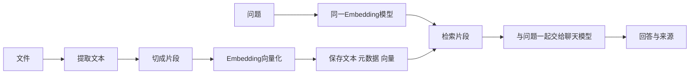

RAG 是“先检索资料，再让模型结合资料回答”。它通常不重新训练模型，而是在每次提问时补充相关文本。

## 两条处理链

Embedding 模型负责把文本变成向量，聊天模型负责生成回答。二者可以不同；文档向量和问题向量必须来自兼容的模型与配置。维度相同也不代表不同模型的向量可以混用。

## 为什么要切片

整份文件可能超出模型限制，也可能把多个话题混在一起。切片保留标题、来源和版本，便于检索并定位原文。片段过短会丢上下文，过长会引入无关内容，需要用真实问题比较效果。

向量相似度表示检索排序依据，不是“答案正确概率”。阈值的含义与距离算法和库有关，不能从 metadata 中随意读取一个 distance 再当统一置信度。

## 怎样确认链路可用

先准备一份自己能核对的短文本：例如设备说明包含“RTSP 端口为 8554”。导入后查询“RTSP 端口是多少”，先检查检索片段是否命中，再检查答案。补测文本里没有答案的问题，观察是否明确说明资料不足。

没有检索结果时，可由程序直接返回“未找到相关资料”，避免仍调用模型要求它自行判断。命中也不保证生成正确，应保留来源并对照原文。提示词不能独自保证零幻觉。

## 资料管理

记录文件 ID、内容版本、片段 ID、模型与维度。重复导入需要更新或删除旧片段，不应不停新增副本。多用户知识库在检索前应用服务端权限过滤，不能只在前端隐藏资料。

先做 [单文件检索实验](/blog/bexf18n36/)。跑通以后，再添加 PDF 解析、增量更新或问答接口，不需要一开始堆上传、消息队列和多个向量库。

参考：[Spring AI ETL](https://docs.spring.io/spring-ai/reference/1.1/api/etl-pipeline.html)、[向量库](https://docs.spring.io/spring-ai/reference/1.1/api/vectordbs.html)。
