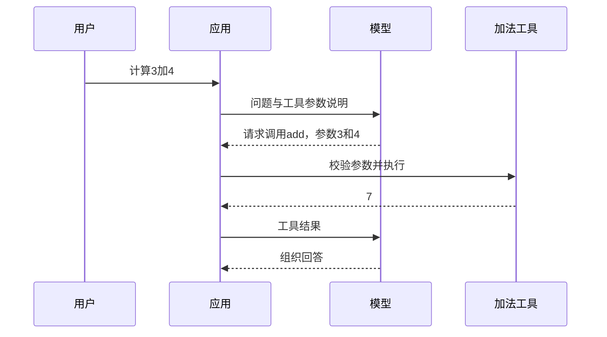

工具调用让模型请求应用执行一个已声明的方法。模型提供候选参数，应用负责真正执行、校验权限和返回结果；不是把数据库或文件权限直接交给模型。

下面沿用 [本地 Spring AI 项目](/blog/b2rlufcv7/) 的 Spring AI 1.1.8 基线。先学习一个只做加法、没有外部副作用的工具。

## 定义工具

保存 `src/main/java/example/CalculatorTools.java`：

```java
package example;

import org.springframework.ai.tool.annotation.Tool;
import org.springframework.ai.tool.annotation.ToolParam;

public class CalculatorTools {
    @Tool(description = "计算两个整数的和")
    public long add(@ToolParam(description = "第一个整数") int a,
                    @ToolParam(description = "第二个整数") int b) {
        return (long) a + b;
    }
}
```

先直接调用 `new CalculatorTools().add(3, 4)`，应得到 7。先转为 long 再加，避免先在 int 中发生溢出。

## 提供给模型

在能够注入 ChatClient.Builder 的现有服务中使用：

```java
String answer = builder.build().prompt()
        .user("请使用加法工具计算 3 加 4")
        .tools(new CalculatorTools())
        .call().content();
```

这个片段放进已有的方法体，不是独立 Java 文件。模型必须支持并正确实现工具调用；普通文本模型可能直接回答而不调用工具。可在 add 方法设断点，确认它确实执行，不能仅看到回复“7”就认定工具调用成功。

## 一次调用经过哪里



`@ToolParam` 说明参数，JSON Schema 能帮助生成结构化参数，但不能代替业务校验。需要访问相机状态时，工具内部调用现有业务 Service，按已登录用户权限过滤；不要接收模型生成的任意 SQL、路径或 URL 并直接执行。

## 加入写操作之前

读状态、加法等可从无副作用工具开始。发通知、修改配置、发布文章等操作需要明确目标、权限、确认和幂等规则，还应限制调用次数和超时。把工具名写进提示词不会自动实现这些规则。

提供普通 `@Tool` 对象与 MCP 工具是两种接入方式。MCP 的连接、工具发现和传输由应用与工具服务负责，详见 [Spring AI MCP](/blog/b2awd9f6e/)。

参考：[Spring AI 1.1 工具调用](https://docs.spring.io/spring-ai/reference/1.1/api/tools.html)。
