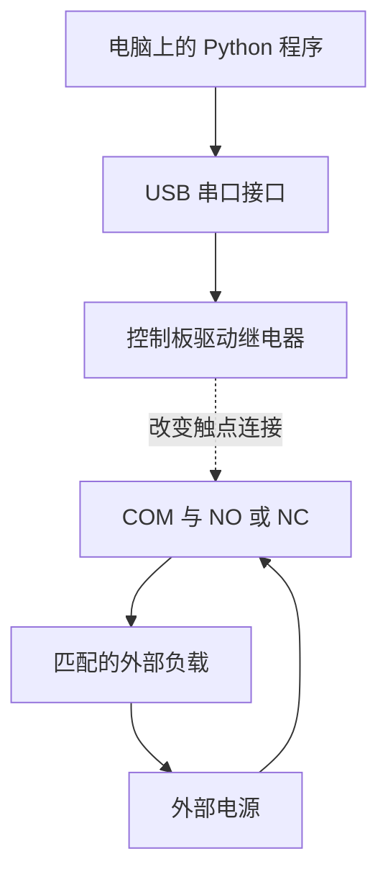

拿到一块 USB 继电器，插进电脑，指示灯亮了，下一步该做什么？

这篇文章从这里开始。不要求你会接线，也不要求你写过 Python。读完后，你应该能分清电源与开关，认识三个接线端子，找到正确的串口，并看懂电脑发出的控制指令。

本文的第一轮实验只做**空载测试**：三个螺丝接线端子全部空着，模块只连接 USB。不要接市电、插座、电机、门锁或正在运行的设备。后面的小灯电路只是解释接线原理的示例，不是已完成的实验。

文章依据是使用者提供的实物照片、原有 `Usb_Test.py`、2026 年 10 月 20 日的本机操作记录，以及文中链接的厂家和软件官方资料。没有完整板卡说明书的地方，会直接写明限制。

## 一、先认识手里的这块板

### 1. 实物上能看见什么

使用者提供的正面照片中，可以读到继电器外壳上的这些字样：

```text
TONGLING
5VDC
10A 250VAC
15A 125VAC
JQC-3FF-S-Z
```

背面写着：

```text
1 Channel
USB Serial Relay
```

背面的三个端子标识是 `NC`、`COM`、`NO`。按原背面照片的方向——USB 插头朝右、端子在左——从上到下是 **NC、COM、NO**。把板翻面或转向后，视觉顺序会变化，所以接线要认字母，不要死记“上面那个”或“左边那个”。

这几处标识各自回答不同的问题：

| 标识 | 可以说明什么 | 不能据此确认什么 |
| --- | --- | --- |
| TONGLING / JQC-3FF-S-Z | 板上继电器元件的品牌和型号 | 整块 USB 板的控制协议 |
| 5VDC | 继电器线圈的额定直流电压 | 三个接线端子会输出 5V |
| 10A 250VAC 等 | 继电器元件的相应触点额定标识 | 裸板、端子和线材都能安全承受同样负载 |
| USB Serial Relay | 这是一块 USB 串口型继电器控制板 | 一定兼容某一套串口指令 |
| 1 Channel | 一路可控制的继电器通道 | 三个端子可以分别独立控制 |

[通灵厂家产品页](https://www.tonglingrelay.com/product/1034.html?productCateId=23)可以帮助辨认 JQC-3FF 系列元件，但链接中的具体产品为 12V 版本，不能拿它替代本次实物上清楚标出的 5V 版本，也不能把元件资料当成整板说明书。

### 2. 蓝色方块和整块板不是同一个东西

蓝色大方块是机械继电器。它本身不认识 Python，也不认识 USB。

整块控制板还需要接收电脑的数据，再驱动继电器动作。本次电脑实际识别到了 `USB-SERIAL CH340 (COM7)`，说明它通过 CH340 这一类 USB 转串口接口与电脑通信。[沁恒的 CH340 产品资料](https://www.wch.cn/products/CH340.html)介绍的是这个通信芯片，不是继电器开关协议。

照片不足以可靠辨认板上所有小芯片的完整型号，因此这里不猜测单片机型号，也不编造电路原理图、光耦隔离规格或保护电路配置。

## 二、继电器到底是怎样的开关

### 1. 先用一盏小灯理解电路

一盏普通低压直流小灯要亮，需要有匹配的电源，并形成完整的回路：

```text
电源正极 → 小灯 → 电源负极
```

在这条回路中间加入一个开关：

```text
电源正极 → 开关 → 小灯 → 电源负极
```

开关闭合时，回路可以导通；开关断开时，这条回路被切断。这里假设电源、小灯及连接本身都正常。

继电器可以承担这个“开关”的角色。不同之处在于，你不需要用手拨动它，而是用电信号驱动内部机构改变触点连接。

### 2. 什么是线圈、触点、吸合、释放

对于本文这种电磁继电器，可以先记住两个部分：

- **线圈**是控制部分。通入合适的驱动电流后产生磁场，使内部机构动作。
- **触点**是开关部分。两个金属接点接触或分离，改变外部电路的通断。

本文用“吸合”和“释放”描述继电器机构的两个状态：

- **吸合**：线圈被驱动，内部机构切换到动作位置。
- **释放**：驱动撤去，正常情况下机构回到释放位置。

不要把这里的“释放”直接理解成“所有外设都关闭”，因为还要看外设接的是 NO 还是 NC。继电器及触点基础术语可对照 [OMRON 通用继电器技术说明](https://www.ia.omron.com/support/guide/17/further_information.html)。这些资料用于解释通用原理，不代表本模块由 OMRON 制造。

### 3. USB 控制回路和外部负载回路要分开理解

“负载”就是你想控制的用电对象，例如一盏灯。模块自身的 USB 供电，与负载需要的电源，是两个不同的问题。



图中的虚线表示“控制触点动作”，不是 USB 电能流向负载。外部回路是原理示意，本次空载实验并不接入它。

本文把 COM/NO/NC 当作无源开关触点使用：**这三个端子不是 USB 的 5V 电源输出口**。同时，机械触点与线圈分开，也不等于这块裸板已经获得适合市电使用的整板安全认证。

## 三、彻底分清 COM、NO、NC

### 1. 三个字母分别是什么意思

| 字母 | 英文 | 中文 | 以线圈未励磁、机构处于释放位置为参照 |
| --- | --- | --- | --- |
| COM | Common | 公共端 | 在两个切换位置间共用的接点 |
| NO | Normally Open | 常开端 | 与 COM 断开 |
| NC | Normally Closed | 常闭端 | 与 COM 接通 |

“常开”“常闭”里的“常”，是指继电器的正常释放状态，不是“程序还没运行”，也不是“USB 插上后一定是什么状态”。板卡上电时如何驱动线圈，要看具体固件，本文没有独立验证它的上电默认行为。

### 2. 对照两个稳定状态看通断

下表描述正常器件在相应机械状态下的触点关系，不是本次已经测得的电阻值。

| 继电器机械状态 | COM ↔ NO | COM ↔ NC |
| --- | --- | --- |
| 释放 | 断开 | 接通 |
| 吸合 | 接通 | 断开 |

例如只接 COM 和 NO，吸合后才导通；如果改接 COM 和 NC，释放时反而导通。使用 NC 时，给模块断电也可能使外部回路接通，因此“拔掉 USB”不能被笼统地当成“外设一定断电”。

触点切换还涉及机械时间、抖动和磨损。这里讨论的是稳定状态，不能用这个简化表推导出精确切换时序或无抖动保证。

### 3. 三个常见误会

**COM 不是 GND。** GND 通常指某个电路的地或参考电位；这里的 COM 是开关公共端，不是让你把它接到电脑地线。

**COM 端子不是 COM7。** 前者是板上的螺丝端子；后者是 Windows 分配给串口的设备名称。名字里都有 COM，但含义完全不同。

**三个端子不是三个通道。** 这是一路转换触点，不是三个可独立开关的输出。初学时不要同时给 NO 和 NC 接两路电源，更不要尝试切换不同电压的电源。

## 四、第一次练习前的安全条件

第一轮的目标仅仅是：让电脑识别设备，发出一次有限时长的控制指令，再观察或测量动作。

开始前检查：

1. COM、NO、NC 三个端子没有接任何外部电源或负载。
2. 模块放在干燥、稳定、绝缘的表面，不接触螺丝、钥匙等金属物。
3. 拿板边，不用手触碰裸露焊点，不对 USB 插头施加扭力。
4. 不接市电、不拆插座、不控制门锁、加热器或其他可能伤人的设备。
5. 如果模块异味、异常发热、冒烟或不断抖动，应停止使用并断开 USB 检查，不继续反复试指令。

外壳上的额定值不能直接变成裸板的实用负载上限。整板走线、接线端子、导线、散热和外壳防护都需要核对。电机、电磁阀等感性负载还涉及启动电流和断开时的能量释放，不能照搬电阻性负载参数。[OMRON 的通用继电器安全注意事项](https://www.ia.omron.com/product/cautions/36/safety_precautions.html)说明了这类区别；它不能替代本板的专用规格书。

## 五、电脑是怎样找到这块板的

### 1. PWR 灯亮，说明到了哪一步

本次使用者确认：插入 USB 后，`PWR` 灯亮了。这是供电指示，不是“控制成功”的证明。

可以把检查分成四层：

| 层次 | 检查对象 | 可以确认的范围 |
| --- | --- | --- |
| 供电 | PWR 指示灯 | 存在相应供电指示，不能证明数据通信正常 |
| 识别 | Windows 中出现 CH340 串口 | 操作系统识别到了串口设备 |
| 发送 | 程序完成串口写入 | 软件完成了指令发送，不等于模块正确执行 |
| 动作 | 声音、SW 灯及触点测量 | 分别提供机构、驱动指示或触点通断证据 |

这四层不要合并成一句“设备已经正常”。

### 2. 用设备管理器查看串口

在 Windows 中：

1. 右键开始菜单，打开“设备管理器”。
2. 展开“端口（COM 和 LPT）”。
3. 找到类似 `USB-SERIAL CH340 (COM7)` 的条目。
4. 记录括号里的串口号；换 USB 口或换电脑后，编号可能不同。

本次实测编号是 **COM7**，不是原脚本默认写的 COM9。

如果只看到蓝牙串口，不要拿它们来试。仅有灰色的历史 CH340 条目，也不能当成当前设备已在线；应查看当前连接的设备，并在空载条件下对比拔插前后的变化。

如果出现未知设备或驱动警告，再检查驱动。CH340 的 Windows 驱动可从 [沁恒官方 CH341SER 下载页](https://www.wch.cn/downloads/ch341ser_exe.html)取得；名称中写 CH341，不代表它不支持 CH340。驱动状态正常、程序也能列出设备时，不需要仅为跟教程而重新安装驱动。

### 3. 本次实际枚举到了什么

本次原脚本 `--list` 输出中的设备行如下，省略了无关的蓝牙串口：

```text
COM7: USB-SERIAL CH340 (COM7) [USB VID:PID=1A86:7523 SER= LOCATION=1-1]
```

`VID:PID=1A86:7523` 是这一 USB 接口的厂商/产品标识。它可以帮助排除误选蓝牙串口，但不是整块板的唯一身份证，也不证明固件兼容 LCUS-1 协议。两块相同 USB 转串口芯片的板可能具有同样标识。

## 六、先准备 Python，不急着控制硬件

### 1. Python、pip、pyserial 分别是什么

| 名称 | 在本文中负责什么 |
| --- | --- |
| Python | 运行 `.py` 程序 |
| pip | 给这个 Python 安装第三方库 |
| pyserial | 让 Python 访问串口的库 |
| PowerShell | 输入启动命令的窗口，不是 Python 解释器 |
| `.venv` | 给这组练习单独准备的 Python 环境 |

安装的包叫 `pyserial`，代码里写的却是 `import serial`，这是正常的。不要为了消除导入错误而随意安装一个叫 `serial` 的其他包。

打开 PowerShell，先输入：

```powershell
python --version
```

本次电脑实际输出为 `Python 3.11.5`。其他电脑不必完全相同；本文教学代码按 Python 3.11 编写和验证。没有 Python 时，可先按 [Python 官方 Windows 使用说明](https://docs.python.org/3.11/using/windows.html)完成安装，并确认命令能运行。

注意输入位置：看到 `PS C:\...>` 通常是 PowerShell；看到 `>>>` 则是在 Python 交互解释器里。本文标成 `powershell` 的命令应在 PowerShell 中运行，不要粘进 `>>>`。

### 2. 创建练习目录和独立环境

下面的变量会指向当前用户目录下的 `Documents\UsbRelayDemo`，不需要把示例中的用户名改成自己的名字。如果你把练习放在别的位置，后续要进入实际保存代码的目录。

```powershell
$relayDemoDir = Join-Path $env:USERPROFILE 'Documents\UsbRelayDemo'
New-Item -ItemType Directory -Path $relayDemoDir -Force | Out-Null
Set-Location -LiteralPath $relayDemoDir
python -m venv .venv
& .\.venv\Scripts\python.exe -m pip install --index-url https://pypi.org/simple pyserial==3.5
```

逐行理解：第一行记住目录，第二行确保目录存在，第三行进入目录，第四行创建独立环境，最后一行只向这个环境安装依赖。`3.5` 是本次实际安装并使用的 pySerial 版本，不是在声称它永远是最新版本。

如果你正在使用本次已经准备好的目录，而且 `.venv\Scripts\python.exe` 能正常运行，就不必重复创建环境和安装依赖。可先检查：

```powershell
& .\.venv\Scripts\python.exe -c "import sys, serial; print(sys.version.split()[0]); print(serial.VERSION)"
```

本次输出为：

```text
3.11.5
3.5
```

这里使用明确的 Python 路径，所以不需要运行 `Activate.ps1`，也不需要为了激活环境去放宽 PowerShell 执行策略。开头的 `&` 是 PowerShell 的调用运算符，用来执行后面的程序路径。虚拟环境的用途和无需激活的运行方式见 [Python venv 文档](https://docs.python.org/3.11/library/venv.html)。

以后重新打开 PowerShell 时，先回到代码目录，再执行后文的相对路径命令：

```powershell
Set-Location -LiteralPath (Join-Path $env:USERPROFILE 'Documents\UsbRelayDemo')
```

### 3. 用 Python 只查看串口

```powershell
& .\.venv\Scripts\python.exe -m serial.tools.list_ports -v
```

这是 pySerial 提供的枚举工具，不是控制命令。查看名称、描述和硬件标识即可，不必打开所有端口测试。[pySerial 串口枚举文档](https://pyserial.readthedocs.io/en/latest/tools.html#module-serial.tools.list_ports)说明了这些字段。

## 七、电脑究竟发了什么

### 1. 本文使用的协议范围

使用者原有 `Usb_Test.py` 按 LCUS-1 风格协议编写，串口设置是 **9600、8N1、无流控**。本文保留这套设置与两条指令，不把它扩展成“所有 CH340 继电器都适用”。

| 参数 | 本文设置 | 入门理解 |
| --- | --- | --- |
| 波特率 | 9600 | 双方约定的通信速率参数 |
| 数据位 | 8 | 每个数据单元包含 8 个数据位 |
| 校验 | N / None | 不使用串口奇偶校验位 |
| 停止位 | 1 | 使用 1 个停止位 |
| 流控 | 关闭 | 不启用本文未使用的软/硬件流控 |

这些是让两端正确交换数据的约定，不能理解成“设置越大越好”。它们的名称与 Python 配置项可对照 [pySerial 的入门示例](https://pyserial.readthedocs.io/en/latest/shortintro.html)。

### 2. 两条指令

| 希望模块执行的动作 | 发送的四个原始字节 | 正常动作后对应的触点关系 |
| --- | --- | --- |
| 释放 | `A0 01 00 A1` | COM 与 NO 断开，COM 与 NC 接通 |
| 吸合 | `A0 01 01 A2` | COM 与 NO 接通，COM 与 NC 断开 |

原脚本引用的 [LCUS-1 社区项目](https://github.com/diyism/usb-controlled-relay-lcus1)及其 [实际发送脚本](https://github.com/diyism/usb-controlled-relay-lcus1/blob/master/deaf_alarm.sh)使用了相同字节序列。它是可核对的参考实现，不是本次这块板的厂家验收证明。

以吸合帧为例，`A0` 用作帧起始标识，`01` 是第一路，后面的 `01` 表示吸合，末尾 `A2` 是校验字节。对本文这两帧，前三个字节之和的低 8 位与末字节相同：

```text
0xA0 + 0x01 + 0x00 = 0xA1
0xA0 + 0x01 + 0x01 = 0xA2
```

`0x` 表示十六进制，例如 `0xA0` 的十进制值是 160。你暂时只需知道：这些是约定好的数值，不是随意写的字符串。

### 3. 不是发送字母 A、数字 0 和空格

这段 Python 会得到四个字节：

```python
command = bytes.fromhex("A0 01 01 A2")
print(len(command))           # 4
print(command.hex(" "))      # a0 01 01 a2
```

而下面这一行得到的是一串可读文字对应的字节，并不相同：

```python
wrong_command = b"A0 01 01 A2"
print(len(wrong_command))     # 11，不是 4
```

因此既不要直接发送字符串 `"1"`，也不要把 `"A0 01 01 A2"` 当普通文本发出去，更不要自行添加回车换行。`bytes.fromhex()` 的作用见 [Python 字节类型文档](https://docs.python.org/3.11/library/stdtypes.html#bytes.fromhex)。

## 八、先下载教学代码，离线演练一遍

本文提供四个文件：

- [relay_control.py：控制程序](/examples/usb-relay/relay_control.py)
- [requirements.txt：依赖版本](/examples/usb-relay/requirements.txt)
- [test_relay_control.py：不连接硬件的单元测试](/examples/usb-relay/test_relay_control.py)
- [README.md：简短操作说明](/examples/usb-relay/README.md)

把文件保存到前面创建的 `UsbRelayDemo` 目录。浏览器如果直接显示源码，可使用“另存为”；确认文件名是 `relay_control.py`，不是 `relay_control.py.txt`。也可以打开记事本，粘贴下一节的完整代码，以 UTF-8 编码、文件类型“所有文件”保存。

在该目录打开 PowerShell：

```powershell
Get-ChildItem -Name
& .\.venv\Scripts\python.exe .\relay_control.py --help
& .\.venv\Scripts\python.exe .\relay_control.py pulse --dry-run
```

最后一行是**演练**，不打开串口、不发送数据，也不真的等待 2 秒。它打印的是程序计划执行的指令，不是硬件测量结果：

```text
[演练/未连接硬件] 释放: A0 01 00 A1
[演练/未连接硬件] 吸合: A0 01 01 A2
[演练] 计划保持 2 秒，本次跳过等待
[演练/未连接硬件] 释放: A0 01 00 A1
结束：未读取实际触点状态。
```

即使电脑没有连接继电器，也应该能完成这一步。演练路径甚至不需要导入 pySerial；安装 Python 后，使用普通 `python .\relay_control.py pulse --dry-run` 也可以练习。

## 九、完整教学代码

这是为本文整理的新程序，**不是把使用者原脚本直接改名**。它增加了无硬件演练、明确选择端口、空载确认、USB 标识检查、有限时长脉冲和离线测试。新程序没有在本次写作中再次驱动实体继电器，其硬件表现仍需要空载确认。

真实发送时，程序只接受本次记录的 `1A86:7523` USB 标识。其他标识的板即使同样使用 CH340，也不在这段程序的当前适用范围内；不要为了绕过检查而盲目修改标识。

如果网页将长代码折叠，可以点击代码块底部的箭头展开；不想手动复制时，直接下载上面的 `relay_control.py`。

```python
"""LCUS-1 风格协议的 USB 串口继电器教学程序。

仅供端子不接外部电路的空载练习。CH340 的 VID/PID 不能证明固件协议。
默认不操作设备；真实发送必须指定端口并提供 --confirm-no-load。
程序不读取机械触点状态，发送成功不等于继电器已动作。
"""

import argparse
import math
import sys
import time


BAUDRATE = 9600
EXPECTED_USB_ID = (0x1A86, 0x7523)
COMMANDS = {
    0: bytes.fromhex("A0 01 00 A1"),
    1: bytes.fromhex("A0 01 01 A2"),
}


def build_command(value):
    """只构造指令，不接触硬件；拒绝 True、False、字符串等输入。"""
    if type(value) is not int or value not in COMMANDS:
        raise ValueError("状态必须是整数 0（释放）或 1（吸合）")
    return COMMANDS[value]


def checked_seconds(value):
    """限制为一次短时练习；也拒绝 nan、inf。"""
    seconds = float(value)
    if not math.isfinite(seconds) or not 0.1 <= seconds <= 10:
        raise ValueError("保持时间必须在 0.1～10 秒之间")
    return seconds


def list_ports():
    """仅枚举串口，不打开串口，也不发送指令。"""
    from serial.tools.list_ports import comports

    ports = sorted(comports(), key=lambda item: item.device)
    if not ports:
        print("未发现串口，请检查 USB 连接和驱动。")
    for item in ports:
        print(f"{item.device}: {item.description} [{item.hwid}]")


def check_target(port):
    """校验本教程这块板的 USB 标识，避免误选蓝牙等其他串口。"""
    from serial.tools.list_ports import comports

    matches = [item for item in comports()
               if item.device.casefold() == port.casefold()]
    if len(matches) != 1:
        raise ValueError(f"未找到唯一的在线串口：{port}")
    if (matches[0].vid, matches[0].pid) != EXPECTED_USB_ID:
        raise ValueError("该端口不是本教程预期的 1A86:7523 设备，停止发送")


def send_state(value, port=None, *, dry_run=False):
    """发送一次状态指令；返回的是指令字节，不是实际继电器状态。"""
    command = build_command(value)
    action = "吸合" if value else "释放"
    if dry_run:
        print(f"[演练/未连接硬件] {action}: {command.hex(' ').upper()}")
        return command
    if not port:
        raise ValueError("真实发送必须明确指定串口")

    import serial

    with serial.Serial(
        port=port,
        baudrate=BAUDRATE,
        bytesize=serial.EIGHTBITS,
        parity=serial.PARITY_NONE,
        stopbits=serial.STOPBITS_ONE,
        timeout=1,
        write_timeout=1,
        xonxoff=False,
        rtscts=False,
        dsrdtr=False,
    ) as connection:
        written = connection.write(command)
        if written != len(command):
            raise OSError(f"发送不完整：{written}/{len(command)} 字节")
        connection.flush()
    print(f"[仅发送，未回读触点] {port} {action}: {command.hex(' ').upper()}",
          flush=True)
    return command


def pulse(port=None, seconds=2, *, dry_run=False):
    """释放 → 吸合 → 等待 → 尝试释放；不做无限循环。"""
    seconds = checked_seconds(seconds)
    send_state(0, port, dry_run=dry_run)
    if not dry_run:
        time.sleep(1)
    try:
        send_state(1, port, dry_run=dry_run)
        if dry_run:
            print(f"[演练] 计划保持 {seconds:g} 秒，本次跳过等待")
        else:
            time.sleep(seconds)
    finally:
        # 即使吸合发送/等待出错，也尝试释放；断线、掉电等仍可能使其失败。
        send_state(0, port, dry_run=dry_run)


def main(argv=None):
    parser = argparse.ArgumentParser(description=__doc__)
    parser.add_argument("action", nargs="?", choices=("on", "off", "pulse"))
    modes = parser.add_mutually_exclusive_group()
    modes.add_argument("--list", action="store_true", help="只列出串口")
    modes.add_argument("--dry-run", action="store_true", help="只打印指令，不连接硬件")
    parser.add_argument("--port", help="实际串口，例如 COM7；没有默认值")
    parser.add_argument("--seconds", default="2", help="pulse 保持时间，0.1～10 秒")
    parser.add_argument("--confirm-no-load", action="store_true",
                        help="确认三个接线端子均未连接外部电路")
    args = parser.parse_args(argv)
    if args.list and args.action:
        parser.error("--list 不能与 on/off/pulse 同时使用")
    if args.action is None and not args.list:
        parser.print_help()
        return 0
    if args.action and not args.dry_run:
        if not args.port:
            parser.error("请先 --list，再使用 --port 明确指定串口")
        if not args.confirm_no_load:
            parser.error("仅供空载练习；确认端子空置后添加 --confirm-no-load")

    try:
        seconds = checked_seconds(args.seconds) if args.action == "pulse" else 2
        if args.list:
            list_ports()
            return 0
        if not args.dry_run:
            check_target(args.port)
        if args.action == "pulse":
            pulse(args.port, seconds, dry_run=args.dry_run)
        else:
            send_state(1 if args.action == "on" else 0, args.port,
                       dry_run=args.dry_run)
        print("结束：未读取实际触点状态。")
        return 0
    except ImportError:
        print("缺少依赖，请用运行本程序的同一个 Python 安装 pyserial。", file=sys.stderr)
    except KeyboardInterrupt:
        print("已中断；不能保证实际已释放，请检查设备。", file=sys.stderr)
        return 130
    except (OSError, ValueError) as exc:
        print(f"操作失败：{exc}；实际状态未知，请检查设备。", file=sys.stderr)
    return 1


if __name__ == "__main__":
    sys.exit(main())
```

## 十、从零看懂这段代码

### 1. import：把需要的工具引进来

`argparse` 负责理解命令行参数；`time` 用来等待；`math` 帮助排除无穷大和无效时长；`sys` 用来返回退出码和输出错误。这四个都是 Python 标准库，不需要另外安装。

`serial` 则来自安装的 pySerial。它被放到真实发送分支中再导入，因此 `--dry-run` 不依赖它。

### 2. def：把一项工作起个名字

`def build_command(value):` 定义一个函数。调用 `build_command(1)` 时，`value` 取得整数 1，函数返回对应的四字节指令。

程序里的 `0` 和 `1` 表示本协议中的释放与吸合。它们不是灯的通用开关值：接 NC 的负载，其通断关系与接 NO 时相反。

`COMMANDS` 是字典，用一个值查找另一份数据；`COMMANDS[1]` 就是取出吸合指令。`return` 把结果交给调用者，不是向设备发指令。

### 3. 串口参数为什么写得这么明确

`serial.Serial(...)` 在指定端口后会打开串口，`connection.write(command)` 才发送数据。`bytesize`、`parity`、`stopbits` 对应前文的 8N1。

`timeout=1` 是读超时设置，`write_timeout=1` 是写超时设置。**写了读超时不代表程序真的读取过设备回复**，这段程序没有调用触点状态读取逻辑。

`written` 保存 pySerial 报告写出的字节数；不是 4 就报错。`flush()` 等待待发送数据写出，不是在等待触点动作，更不是“继电器已吸合”的确认。串口构造、字节写入和 `flush()` 的准确行为见 [pySerial API 文档](https://pyserial.readthedocs.io/en/latest/pyserial_api.html)。

关闭流控也不等于把所有串口控制线固定为低电平。pySerial 文档提醒，某些系统或驱动在打开端口时可能改变 RTS/DTR，甚至出现短暂跳变。没有完整板卡电路和实测，不能据此保证打开串口时设备绝不会产生其他动作，这也是本文只允许空载练习的原因之一。

### 4. with：用完关闭串口

`with serial.Serial(...) as connection:` 管理这一段串口资源。离开代码块时关闭端口，即使块内抛出异常也会执行相应清理。

**关闭串口不等于释放继电器。** 关闭的是电脑与设备的通信句柄，不是向模块发送 `A0 01 00 A1`。模块是否维持先前驱动状态由固件决定，不能靠退出 Python 来代替释放指令。

### 5. try / finally：等待出错也尝试释放

`pulse()` 先发释放，等待 1 秒，再进入包含吸合与保持的代码段。无论吸合发送或保持阶段是否抛出异常，`finally` 都会尝试再发一次释放。

这里使用“尝试”而不是“保证”：设备掉线、端口打不开、电脑掉电、进程被强制终止或触点故障时，软件都可能无法完成预期动作。普通 Python 程序不能取代安全联锁或硬件急停。

`--seconds 2` 控制的是两次发送之间的程序等待时间，正常运行时约 2 秒，并不是经过标定的触点闭合时长。操作系统调度、串口发送和机构动作都会影响实际时序。

### 6. 命令行参数怎样对应函数

| 命令部分 | 程序中的意思 |
| --- | --- |
| `--list` | 调用 `list_ports()`，只枚举 |
| `on` | 调用 `send_state(1, ...)` |
| `off` | 调用 `send_state(0, ...)` |
| `pulse` | 调用 `pulse(...)`，执行有限时长序列 |
| `--port COM7` | 指定本次实际检查过的串口 |
| `--dry-run` | 打印指令，不连接硬件 |
| `--confirm-no-load` | 操作者确认端子没有外部接线；不是软件自动检测结果 |

代码中的 `*` 表示后续参数按名字传入，例如 `dry_run=True`；代码缩进表示哪些语句属于哪个函数或分支，复制时不要删掉行首空格。文件末尾的 `if __name__ == "__main__":` 让直接运行文件时执行命令行入口，供测试导入时则不自动操作设备。

## 十一、四个循序渐进的练习

以下命令都假设你在保存了代码的 `UsbRelayDemo` 目录中。**真实发送前必须重新确认端口号，并确保三个端子没有外部接线。** 若实际端口不是 COM7，应替换命令中的编号，而不是把设备名称硬改成 COM7。

### 练习 1：只枚举，不发送

```powershell
& .\.venv\Scripts\python.exe .\relay_control.py --list
```

对照设备管理器找到 CH340 条目。没有找到就停在这一层，不要猜端口、不遍历发送。

### 练习 2：不接硬件，改变保持时间

```powershell
& .\.venv\Scripts\python.exe .\relay_control.py pulse --seconds 1 --dry-run
```

观察输出中的“计划保持 1 秒”。程序为教学练习限制在 0.1～10 秒；这是本文自行设置的使用限制，不是厂家公布的最大吸合时间。

### 练习 3：真实空载脉冲

确认实物和端口后，一次只运行下面这一条：

```powershell
& .\.venv\Scripts\python.exe .\relay_control.py pulse --port COM7 --seconds 2 --confirm-no-load
```

程序计划执行：释放 → 等待 1 秒 → 吸合 → 等待约 2 秒 → 尝试释放。

执行前先留意模块，观察 `SW` 灯是否随指令变化，听有没有切换声。通常初始释放时若原本已释放，不会再有一次明显切换声；不能机械地认为发三条指令就一定听到三声。`SW` 的具体电路连接没有完整板卡资料，因此它只能作为指示观察，不能直接当成触点测量。

没有声音或指示变化时，不要开启无限循环“多试几次”。先按后面的排障表检查协议、串口和供电。

### 练习 4：分别理解 on 与 off

仍然只允许空载。先读完两条命令及说明，再操作：

```powershell
& .\.venv\Scripts\python.exe .\relay_control.py on --port COM7 --confirm-no-load
```

这条只发送一次吸合指令，**不会自动定时释放**。观察后，执行：

```powershell
& .\.venv\Scripts\python.exe .\relay_control.py off --port COM7 --confirm-no-load
```

这条只发送释放指令。如果你不熟悉手动分两次操作，先使用练习 3 的 `pulse`。

## 十二、怎样确认触点真的通断

只听声音能提供机构动作的线索；只看 SW 灯能提供指示电路变化的线索。要检查 COM 与 NO/NC 的电连接，需要测量触点。

### 1. 使用万用表前的条件

这一步是待执行的验证方法，**本次没有实际万用表读数**。你需要先看所用万用表的说明书，认识通断档或电阻档。

- 不连接任何外部负载或外部电源，尤其不能接市电。
- 表笔插在说明书要求的 COM 和 V/Ω 插孔，不要留在 A/mA 电流插孔。
- 不对带外部电压的电路使用通断/电阻档。
- USB 只给控制部分供电；测量只接触已与外部电路断开的 COM、NO、NC 触点，不去碰其他焊点。
- 如果不能确认被测端子没有外加电压，停下，请熟悉仪表的人协助。

### 2. 比较两个状态，而不是编一个“标准实测值”

先固定表笔位置，再运行一次空载脉冲；不要一边移动表笔一边输入命令。

| 测量对象 | 释放时预期 | 吸合时预期 |
| --- | --- | --- |
| COM 与 NO | 不导通 | 导通 |
| COM 与 NC | 导通 | 不导通 |

不同万用表的蜂鸣阈值、显示符号和响应速度不同，按仪表说明判断。本文不编造“测得 0.0Ω”或其他读数；这种方法也是入门通断检查，不是四线法触点电阻检测、绝缘测试或整板安全认证。

## 十三、一个低压小灯的接线原理实例

本节用于解释“电源从哪里来、开关放在哪里”，**不是本次已接线并点亮的实验**。接入任何负载前，仍需取得板卡资料并核对电压、电流、端子、线材和必要保护。本教程的代码特意要求空载确认，接入小灯后便不再符合它的使用前提，不要带着外部接线虚假填写 `--confirm-no-load`。

假设以后选择一盏额定 5V 直流、内部已包含限流设计的小功率成品 LED 指示灯，并使用与它匹配、具有适当限流或保护的独立 5V 电源，开关原理如下：

```text
外部 5V 电源正极 ── COM
                       继电器触点
                    NO ── 成品 5V 指示灯正极
外部 5V 电源负极 ───────── 成品 5V 指示灯负极

NC：这个示例中不接
USB：单独连接电脑，给控制板供电并通信
```

需要先把 USB 与外部电源都断开，再由确认了端子含义的人接线、检查，不能带电调整。实作时电源保护与布线不能因为本图省略了细节就省略。

正常释放时 COM 与 NO 断开，这条灯的回路不完整；正常吸合后两者接通，外部电源才能沿这条回路给灯供电。电流来自**外部电源**，不是 COM 自己产生的。

这里不把外部电源负极接到电脑 USB 的 GND；对于这种单纯串联机械触点的回路，不应为了“看起来需要共地”就额外连线。也不要把外部电源正负极直接接在 COM 与 NO 两端：触点一旦闭合，就可能把电源短路。

示例中的“成品 5V 指示灯”不是一颗裸 LED。裸 LED 需要按其正向压降和额定电流设计限流，不能直接接 5V；不了解这些参数时，不用裸 LED 替代。电压低也不代表短路不会发热，接入负载后的实际操作应作为另外一次有明确器材和条件的实验。

## 十四、本次到底验证到了哪一步

下面记录的是写作前在使用者电脑上的操作，不是为文章虚构的完整成功案例。

| 项目 | 本次证据或状态 |
| --- | --- |
| 实物标识 | 使用者提供了正反面照片，读到 JQC-3FF-S-Z、5VDC、USB Serial Relay 和端子标识 |
| 外部接线 | 照片中的三个端子为空；操作前已要求继续保持空载 |
| PWR 灯 | 使用者明确反馈“已插好，PWR 灯亮了” |
| USB 识别 | 发现在线的 USB-SERIAL CH340 (COM7)，设备状态为 OK |
| USB 标识 | 1A86:7523 |
| 运行环境 | Python 3.11.5，独立虚拟环境中的 pySerial 3.5 |
| 指令发送 | 原有 Usb_Test.py 的函数完成释放、吸合、再次释放发送，过程无报错 |
| 控制间隔 | 原测试在吸合发送后等待约 2 秒，再发送释放 |
| 动作声音 / SW 灯 | 截至写作时，尚未收到使用者的动作确认 |
| 触点通断 | 没有万用表实测证据 |
| 外部负载 | 未连接、未测试 |
| 本文新教学程序 | 完成离线软件验证，没有为写作而再次驱动实体板卡 |

原测试实际输出中的发送记录为：

```text
Initial RELEASE command sent: A0 01 00 A1
ENERGIZE command sent: A0 01 01 A2
Final RELEASE command sent: A0 01 00 A1
Test finished. Commands sent only; physical relay state has not been read back.
```

因此准确的说法是：**本机已识别 USB 串口设备，并成功完成这三条指令的串口发送；实体动作及触点通断仍待确认。** 不能写成“实测继电器工作正常”“灯已经点亮”或“已证明这块板完全兼容 LCUS-1”。

原脚本默认 COM9，本次通过显式指定 COM7 使用，没有改动原文件。原脚本的 `1/0` 与本文教学程序的 `on/off` 参数形式不同，不能混着使用；也不要把本文的 `--dry-run`、`pulse` 等新参数传给原脚本。

## 十五、报错和没有动作时，按什么顺序排查

| 现象 | 先检查什么 | 不应直接下的结论 |
| --- | --- | --- |
| PWR 不亮 | USB 是否插牢、接口是否供电；换一个正常接口对比 | 不能只凭此确定继电器元件坏了 |
| PWR 亮，但没有 CH340 串口 | 当前连接的是哪台电脑、USB 数据连接、设备管理器警告和官方驱动 | 灯亮不代表数据连接正常；也不能直接认定一定缺驱动 |
| 只有灰色 COM7 历史条目 | 看当前设备列表，空载拔插前后对比 | 历史记录不等于设备在线 |
| `No module named 'serial'` | 使用运行脚本的同一个 `.venv\Scripts\python.exe` 安装 pyserial | 不能仅因为其他 Python 装过就认为当前环境也有 |
| 找不到 `relay_control.py` | 当前目录、下载位置、是否被保存成 `.py.txt` | 不是串口或硬件故障 |
| 提示必须指定端口/确认空载 | 先核实端子空置及实际端口，再补参数 | 不要在没有确认条件时随手加确认参数 |
| 找不到指定 COM 口 | 设备是否仍在线、端口号是否变化 | 不要改成另一个蓝牙 COM 口碰碰运气 |
| 拒绝访问、端口打不开 | 其他 Python 程序、串口工具是否占用，设备是否掉线 | 不应把一切都归因于权限，也不要立即强杀未知进程 |
| USB 标识检查不通过 | 是否选错设备、是否是不同板型 | 相同外壳继电器不代表同一块控制板 |
| 发送无报错，但无动作线索 | 协议是否匹配、9600/8N1 是否对应说明书、供电和板卡状态 | 四字节写入成功不证明固件接收并执行 |
| 有声音，但外部电路没变化 | 在无外部电源的条件下核对端子和通断；负载问题另行检查 | 声音不能证明所有触点都正常 |
| 程序结束后状态仍不明确 | 查看最后是否成功发出释放，并独立检查；不再连接危险负载 | 退出进程、关闭串口不保证外设断电 |

串口被占用时，先正常关闭自己打开的串口工具或程序，再试一次。遇到“发送成功但不动作”，应向卖家索取**整块板的型号、协议、波特率及说明书**。不要连续猜测其他设备协议，更不要在接着负载时自动扫描指令。

本文没有实现设备状态查询。网上看到某个板支持查询指令，并不能据此断言这块板也支持；即使固件返回“ON”，也需要区分它报告的是内部控制状态，还是独立测量的机械触点状态。

## 十六、怎样自己验证程序，又不让硬件动作

将下载的 `relay_control.py` 与 `test_relay_control.py` 放在同一目录，运行：

```powershell
& .\.venv\Scripts\python.exe -B -m unittest discover -s . -p test_relay_control.py -v
```

这组测试用替身模拟串口，不连接真实设备。它检查指令字节、参数校验、只枚举不打开端口、写入不完整时报错、脉冲顺序，以及吸合或保持阶段异常后尝试释放等行为。

`-B` 表示不生成 Python 字节码缓存。测试通过只能说明这些软件逻辑符合测试预期，不能代替 USB 驱动测试、实体触点测量、负载试验或电气安全验收。

这次练习完成的判断依据应当是：能找到正确串口，知道每条指令准备做什么，能说明 COM/NO/NC 的关系，并对实际观察到的动作保留记录。如果目前只有“发送无报错”，就把记录停在这里，不补写未发生的成功结果。

## 资料来源与适用边界

资料核对日期：2026 年 10 月 20 日。

- [通灵 JQC-3FF-S-Z 产品资料](https://www.tonglingrelay.com/product/1034.html?productCateId=23)：用于区分继电器元件与控制板；链接为 12V 产品，不替代本文 5V 实物标识。
- [沁恒 CH340 产品资料](https://www.wch.cn/products/CH340.html)、[官方 CH341SER 驱动](https://www.wch.cn/downloads/ch341ser_exe.html)：USB 转串口芯片及 Windows 驱动来源。
- [LCUS-1 社区参考项目](https://github.com/diyism/usb-controlled-relay-lcus1)：与原脚本一致的协议参考，不是本板的厂家兼容证明。
- [Python 3.11 Windows 使用说明](https://docs.python.org/3.11/using/windows.html)、[venv](https://docs.python.org/3.11/library/venv.html)、[bytes.fromhex](https://docs.python.org/3.11/library/stdtypes.html#bytes.fromhex)：运行环境与字节构造依据。
- [pySerial 入门](https://pyserial.readthedocs.io/en/latest/shortintro.html)、[API](https://pyserial.readthedocs.io/en/latest/pyserial_api.html)、[串口枚举](https://pyserial.readthedocs.io/en/latest/tools.html#module-serial.tools.list_ports)：串口编程依据。
- [OMRON 通用继电器术语](https://www.ia.omron.com/support/guide/17/further_information.html)、[通用继电器安全注意事项](https://www.ia.omron.com/product/cautions/36/safety_precautions.html)：解释通用触点原理与负载限制，不提供本控制板的额定能力保证。

本文不提供 220V 接线步骤，不声称验证过断电默认状态、上电状态、整板最大负载、长期寿命、绝缘等级或安全联锁能力。
