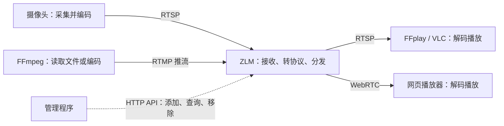

ZLMediaKit，简称 ZLM，是一个流媒体服务器。它接收视频流，再把这路视频提供给不同的播放器。摄像头、FFmpeg 或 OBS 可以提供视频，VLC、FFplay 和网页播放器负责观看。

本文先用一段自己生成的视频完成接入和播放，再换成摄像头。命令使用 Windows PowerShell；示例对应本地 ZLM `de04a56` 和 FFmpeg `7.1.1`。

## 1. 视频经过 ZLM 时，发生了什么

摄像头先把连续画面压缩成 H.264 或 H.265，再通过 RTSP 等协议输出。ZLM 接收这些已经编码的数据，解析视频轨道和时间戳，按照输出协议重新组织并发送。播放器收到后解码，才得到屏幕上的画面。



这里有三种不同操作：

| 操作 | 具体做了什么 | 本文由谁完成 |
| --- | --- | --- |
| 编码 | 把原始画面压缩成 H.264 等格式 | FFmpeg，或摄像头内部的编码器 |
| 转协议 | 例如接收 RTMP，再通过 RTSP 或 WebRTC 输出，保留视频编码 | ZLM |
| 转码 | 解码后重新编码，例如 H.265 转 H.264，或把 720p 改成 360p | FFmpeg |

ZLM 的常规转发不会把每帧视频解码后重新编码。因此，**H.265 流经过 ZLM，通常仍然是 H.265**；换一个播放协议，不会自动解决播放器不支持编码的问题。各协议能承载什么编码，还要同时满足 ZLM 和播放器的支持范围。参见 [ZLM 功能说明](https://docs.zlmediakit.com/zh/guide/)。

## 2. 启动本地 ZLM

本机目录分成源码和可运行程序：

```text
D:\Developer Tools\ZLMediaKit
├─ ZLMediaKit       源码与编译目录
└─ runtime-local    本文使用的运行目录
   ├─ MediaServer.exe
   ├─ config.ini
   └─ www\webrtc    自带的 WebRTC 测试页
```

先打开一个 PowerShell 窗口，下面称为**窗口 A**：

```powershell
Set-Location 'D:\Developer Tools\ZLMediaKit\runtime-local'
.\MediaServer.exe -c .\config.ini --log-dir .\logs
```

`-c` 指定配置文件，`--log-dir` 指定日志目录。出现监听日志后，保持这个窗口运行。按 `Ctrl+C` 会停止服务。

本机 `config.ini` 的关键设置如下。其他安装环境以自己的文件为准：

| 配置 | 本机值 | 用途 |
| --- | --- | --- |
| `[general] listen_ip` | `127.0.0.1` | 只允许本机连接 |
| `[http] port` | `8088` | 网页、管理 API、HTTP-FLV、HLS |
| `[rtsp] port` | `8554` | RTSP 接入和播放 |
| `[rtmp] port` | `1935` | RTMP 接入和播放 |
| `[rtc] port` / `tcpPort` | `18000` | WebRTC 媒体传输 |
| `[rtc] externIP` | `127.0.0.1` | 告诉 WebRTC 播放器连接哪个媒体地址 |

浏览器打开 [本地 WebRTC 测试页](http://127.0.0.1:8088/webrtc/)。页面能打开，说明 HTTP 服务可用；此时还没有视频源，播放器没有画面是正常的。

## 3. 先加入一段不依赖摄像头的视频

### 生成测试视频

打开**窗口 B**，确认 FFmpeg 已加入 PATH：

```powershell
ffmpeg -version
ffprobe -version
ffplay -version
```

这三个工具分别负责处理视频、查看视频信息和播放视频。本机已经安装；若提示找不到命令，需要先配置 FFmpeg 的 `bin` 目录。

创建练习目录，生成 12 秒的动态测试画面：

```powershell
New-Item -ItemType Directory -Path "$env:USERPROFILE\Videos\zlm-demo" -Force | Out-Null
Set-Location "$env:USERPROFILE\Videos\zlm-demo"
ffmpeg -f lavfi -i "testsrc2=size=1280x720:rate=25" -t 12 -an -c:v libx264 -pix_fmt yuv420p -preset veryfast -tune zerolatency -g 50 -bf 0 demo.mp4
```

| 参数 | 含义 |
| --- | --- |
| `-f lavfi -i "testsrc2=..."` | 生成 1280×720、每秒 25 帧的测试画面 |
| `-t 12` | 输出 12 秒 |
| `-an` | 不输出音频，先只练习视频 |
| `-c:v libx264` | 用 x264 编码器生成 H.264 视频 |
| `-pix_fmt yuv420p` | 使用常见的 8 位像素格式，便于播放器兼容 |
| `-preset veryfast` | 选择编码速度档位 |
| `-tune zerolatency -bf 0` | 使用低延迟编码设置，并禁用 B 帧 |
| `-g 50` | 关键帧间隔上限为 50 帧，在 25 fps 下对应 2 秒 |

可以先播放文件，确认素材正常：

```powershell
ffplay .\demo.mp4
```

播放窗口中按 `q` 退出。这个 MP4 目前只是磁盘上的文件，ZLM 还没有收到它。

### 把文件推送给 ZLM

仍在窗口 B 执行：

```powershell
ffmpeg -re -stream_loop -1 -i .\demo.mp4 -an -c:v copy -f flv "rtmp://127.0.0.1:1935/live/test"
```

- `-re`：按素材的正常播放速度读取，避免把文件一下子发完。
- `-stream_loop -1`：循环读取文件，作为持续的视频源。
- `-c:v copy`：直接复制已经编码的视频，不重新编码。
- `-f flv`：把视频装入 FLV 格式，通过 RTMP 发给 ZLM。

`frame` 和 `time` 持续增长，表示 FFmpeg 正在发送数据。保持窗口 B 运行；按 `Ctrl+C` 停止推流。`-re` 适合这里的文件模拟直播，摄像头本身已经按实时速度输出，一般不需要再加。

这条命令的参数位置和 `copy` 行为可查 [FFmpeg 命令说明](https://ffmpeg.org/ffmpeg.html#Streamcopy)。

### 看懂流地址

```text
rtmp://127.0.0.1:1935/live/test
       服务器地址   端口  app  stream
```

`live` 是应用名，可以理解为一组流的名称；`test` 是这一条流的名称。它们不要求你提前创建文件夹，也不需要先调用“创建流”接口。FFmpeg 开始推送后，ZLM 才会注册这路流。

以后接入另一条视频，可以换成 `live/camera02`。两路同时存在的视频要使用不同的流名称。

## 4. 播放刚才的流

### 用 FFplay 播放 RTSP

打开**窗口 C**：

```powershell
ffplay -rtsp_transport tcp "rtsp://127.0.0.1:8554/live/test"
```

看到与测试文件相同的动态画面，就完成了这条路径：

```text
demo.mp4 → FFmpeg 通过 RTMP 推送 → ZLM → FFplay 通过 RTSP 播放
```

推送使用 RTMP，播放使用 RTSP，视频编码仍然是 H.264。`-rtsp_transport tcp` 让 RTSP 会话中的媒体数据走 TCP。播放窗口按 `q` 退出，不影响窗口 B 继续推流。

### 在浏览器里播放

打开 [test 流的 WebRTC 测试页](http://127.0.0.1:8088/webrtc/?app=live&stream=test&type=play)：

1. `method` 选择 `play`。
2. 保持 `videoEnable` 勾选，取消 `audioEnable`。
3. 确认 `url` 是下面的地址，然后点击 **开始(start)**。

```text
http://127.0.0.1:8088/index/api/webrtc?app=live&stream=test&type=play
```

上面这个 URL 是播放器交换连接信息的**信令接口**。网页中的 JavaScript 会向它发送请求，再建立 WebRTC 连接；直接把这个接口地址粘贴到浏览器地址栏，不会出现播放页面。

这版测试页在 HTTP 下可能弹出“推流需要 HTTPS”的提示。本节使用本机地址接收现有流，保持 `play` 模式即可，不需要打开电脑摄像头或麦克风。左边的自动流列表还涉及管理 API 鉴权；列表为空时，仍可手动填写上面的 URL 播放。

本机配置会为无音频流补静音 AAC；这里关闭音频接收，避免把音频兼容问题混入视频练习。正式接入时，音频也要核对编码，不能只检查视频。

### 同一条流的不同地址

当前配置已开启 RTSP、RTMP 和 HLS 输出：

| 访问方式 | 地址 | 如何使用 |
| --- | --- | --- |
| RTSP | `rtsp://127.0.0.1:8554/live/test` | FFplay / VLC |
| RTMP | `rtmp://127.0.0.1:1935/live/test` | 支持 RTMP 的播放器 |
| HTTP-FLV | `http://127.0.0.1:8088/live/test.live.flv` | FFplay，或配有 FLV 播放库的网页 |
| HLS | `http://127.0.0.1:8088/live/test/hls.m3u8` | FFplay，或支持 HLS 的网页播放器 |
| WebRTC 页面 | `http://127.0.0.1:8088/webrtc/?app=live&stream=test&type=play` | 浏览器打开后点击播放 |

浏览器不会原生播放 RTSP。HTTP-FLV 和 HLS 地址也不等于网页：Windows 浏览器通常需要相应的 JavaScript 播放器。想先确认 ZLM 是否正常输出，可以在窗口 C 执行：

```powershell
ffplay "http://127.0.0.1:8088/live/test.live.flv"
```

HLS 会先生成播放列表和分片，首次访问需要等分片产生，延迟通常高于本文的 WebRTC 播放方式。地址格式见 [ZLM 播放 URL 规则](https://docs.zlmediakit.com/zh/guide/media_server/play_url_rules.html)。

## 5. 用 API 查询和加入视频流

### 查询当前有哪些流

在窗口 C 中读取本机配置里的 API 密钥。赋值不会把密钥打印到终端：

```powershell
$zlmDir = 'D:\Developer Tools\ZLMediaKit\runtime-local'
$api = 'http://127.0.0.1:8088/index/api'
$secret = (Select-String -LiteralPath "$zlmDir\config.ini" -Pattern '^secret=(.*)$').Matches.Groups[1].Value

$media = Invoke-RestMethod -Method Post -Uri "$api/getMediaList" -Body @{ secret = $secret; app = 'live'; stream = 'test' } -TimeoutSec 10
if ($media.code -ne 0) { throw $media.msg }
$media.data | Select-Object schema, app, stream, readerCount
```

`code=0` 表示接口调用成功。结果中可能同时出现 `rtsp`、`rtmp`、`hls` 等多行，它们是同一条视频的不同协议输出。`readerCount` 是对应协议媒体源上的读取者数量。

ZLM 内部通过 `schema + vhost + app + stream` 定位媒体源。本文没有开启虚拟主机，使用 `__defaultVhost__` 即可。

这份 `de04a56` 版本在本机请求中也校验管理接口凭据。不带正确 `secret` 可能返回 `Please login first`，不能沿用旧教程里“127.0.0.1 可以省略密钥”的写法。当前实现见 [WebApi.cpp 中的鉴权与 API 注册](https://github.com/ZLMediaKit/ZLMediaKit/blob/de04a56c2bc4279f06e583fcc62909cc04177231/server/WebApi.cpp)。密钥只用于管理调用，不要放到公开网页中。

### 让 ZLM 主动拉取一条 RTSP 流

刚才由 FFmpeg 主动发送，叫**推流**。现在让 ZLM 主动连接一个源地址，叫**拉流**。摄像头通常提供 RTSP 地址，可以用这种方式接入。

先继续使用窗口 B 的测试流，把它当作 RTSP 来源，练习添加一个名为 `camera01` 的代理：

```powershell
$source = 'rtsp://127.0.0.1:8554/live/test'
$body = @{
    secret = $secret
    vhost = '__defaultVhost__'
    app = 'live'
    stream = 'camera01'
    url = $source
    rtp_type = 0
    timeout_sec = 10
    retry_count = 3
    enable_rtsp = 1
    enable_rtmp = 1
    enable_hls = 1
    enable_mp4 = 0
    auto_close = 0
}
$proxy = Invoke-RestMethod -Method Post -Uri "$api/addStreamProxy" -Body $body -TimeoutSec 20
if ($proxy.code -ne 0) { throw $proxy.msg }
$proxyKey = $proxy.data.key
$proxyKey
```

成功后会得到类似 `__defaultVhost__/live/camera01` 的 key。保存它，移除代理时还要用。

- `url` 是来源地址；`app` 和 `stream` 决定 ZLM 对外提供的新地址。
- `rtp_type=0` 表示通过 TCP 拉取 RTSP。
- `timeout_sec=10` 是拉流超时；`retry_count=3` 限制失败重试次数。
- `enable_*` 决定输出哪些协议；`enable_mp4=0` 关闭 MP4 录像。
- `auto_close=0` 让练习中的代理在无人观看时继续保留。

在窗口 C 播放：

```powershell
ffplay -rtsp_transport tcp "rtsp://127.0.0.1:8554/live/camera01"
```

此时的路径是 `live/test → ZLM 拉流代理 → live/camera01`。两个流名称必须不同，避免把来源和目标混在一起。

这些参数与删除接口见 [ZLM RESTful API 文档](https://docs.zlmediakit.com/zh/guide/media_server/restful_api.html)。

### 换成真实摄像头

先从设备配置、厂商文档或 ONVIF 客户端取得可用的 RTSP 地址。不同厂商、通道和主子码流的路径可能不同，不能只替换 IP 后猜地址。

在窗口 C 输入地址，并先直接检查来源：

```powershell
$source = Read-Host '输入摄像头的完整 RTSP 地址'
ffprobe -v error -rtsp_transport tcp -timeout 10000000 -select_streams v:0 -show_entries stream=codec_name,width,height,r_frame_rate -of default=noprint_wrappers=1 "$source"
```

`-timeout 10000000` 在这里表示 10 秒的 socket I/O 超时，单位是微秒。正常时可以看到 `codec_name=h264` 或 `hevc`、分辨率和帧率。也可以用 `ffplay -rtsp_transport tcp "$source"` 直接观看。

来源能访问后，沿用上面的参数，只改来源和新流名：

```powershell
$body.url = $source
$body.stream = 'camera02'
$camera = Invoke-RestMethod -Method Post -Uri "$api/addStreamProxy" -Body $body -TimeoutSec 20
if ($camera.code -ne 0) { throw $camera.msg }
$cameraKey = $camera.data.key
```

随后访问 `rtsp://127.0.0.1:8554/live/camera02`。网页播放时，把测试页中的 `stream=test` 改成 `stream=camera02`。

API 请求会按表单编码参数，不需要手工拼接一长串带 `&` 的管理 URL。摄像头地址中的账号、密码若包含 `@`、`#` 等字符，仍须按 URL 规则处理。完整地址可能含凭据，不要直接贴进公开日志。

### 移除代理

结束 `camera01` 练习后，在窗口 C 执行：

```powershell
$removed = Invoke-RestMethod -Method Post -Uri "$api/delStreamProxy" -Body @{ secret = $secret; key = $proxyKey } -TimeoutSec 10
$removed | ConvertTo-Json -Depth 3
```

`code=0` 且 `data.flag=true` 表示本次移除了代理。删除真实摄像头代理时，将 `$proxyKey` 换成 `$cameraKey`。

`addStreamProxy` 创建的是运行中的代理，重启 ZLM 后需要重新添加。自己的应用可以保存摄像头地址和流名称，在启动或需要观看时调用 API；`config.ini` 主要配置服务行为，不会自动替你保存这份摄像头清单。

## 6. 需要改变编码或分辨率时，用 FFmpeg

先检查来源，再决定是否转码：

| 需求 | 做法 |
| --- | --- |
| 来源是 H.264，播放器和输出协议都兼容 | 优先直接代理或 `-c:v copy` |
| 来源是 H.265，目标播放器不支持 | 在相机上改为 H.264，或用 FFmpeg 转码 |
| 修改分辨率、帧率，或在画面上加字 | 解码后处理，再编码 |
| 画面能播但音频不能播 | 检查音频编码和播放器支持，单独处理音频 |

H.264 也有 profile、像素格式和 B 帧等差异。先用本文生成的 H.264、`yuv420p`、无 B 帧样本验证 WebRTC，再排查真实源，能减少干扰。

### 实际转出一条 360p、15 fps 的流

保持窗口 A、B 运行，另开一个 PowerShell 窗口执行：

```powershell
ffmpeg -rtsp_transport tcp -timeout 10000000 -i "rtsp://127.0.0.1:8554/live/test" -an -vf "scale=640:-2,fps=15" -c:v libx264 -preset veryfast -tune zerolatency -crf 23 -pix_fmt yuv420p -g 30 -bf 0 -f flv "rtmp://127.0.0.1:1935/live/camera_h264"
```

这次 FFmpeg 会解码来源，调整画面，再编码成 H.264 推给 ZLM：

```text
来源 H.264 / H.265 → FFmpeg 解码 → 缩放、调整帧率 → 编码成 H.264 → ZLM 分发
```

| 参数 | 这次的作用 |
| --- | --- |
| `-vf "scale=640:-2,fps=15"` | 宽度改为 640，按比例计算偶数高度；帧率改为 15 |
| `-crf 23` | 设置 x264 的质量档位；通常越小质量越高、码率越大，并非固定码率 |
| `-g 30` | 在 15 fps 下，将关键帧间隔上限设为 2 秒 |
| `camera_h264` | 使用新的目标流名，保留原来的 `test` |

在窗口 C 验证输出：

```powershell
ffprobe -v error -rtsp_transport tcp -timeout 10000000 -select_streams v:0 -show_entries stream=codec_name,width,height,r_frame_rate -of default=noprint_wrappers=1 "rtsp://127.0.0.1:8554/live/camera_h264"
```

本例应看到 `h264`、`640`、`360`、`15/1`。WebRTC 页面中的 `stream` 换成 `camera_h264`，即可观看新流。按 `Ctrl+C` 停止转码进程。

真实摄像头是 H.265 时，把 `-i` 后面的来源换成摄像头地址，同一条命令就会执行 H.265 → H.264 转码。处理本地文件时，去掉 `-rtsp_transport tcp -timeout 10000000`，改用 `-re -i "D:\Videos\input.mp4"`，后面的处理和输出参数可以保留。

参数依据见 [FFmpeg scale / fps 文档](https://ffmpeg.org/ffmpeg-filters.html) 和 [libx264 编码器文档](https://ffmpeg.org/ffmpeg-codecs.html#libx264_002c-libx264rgb)。

### 音频怎么处理

本文的命令都用 `-an` 暂时去掉音频。需要为 RTMP、HTTP-FLV 或 HLS 输出常见的 AAC 音频时，可以把它换成 `-c:a aac -ar 48000 -b:a 128k`，前提是来源本身有音频。

WebRTC 还要单独匹配双方支持的音频编码，例如 Opus、G.711；不能认为 AAC 换成 WebRTC 就会自动变成 Opus。视频先播通，再处理音频，比同时排查两种编码更容易定位。

## 7. 其他电脑为什么访问不到

本文的 `127.0.0.1` 始终表示“发起请求的这台电脑”。在另一台电脑上填写它，连接的是另一台电脑自己。

本机配置还将 `listen_ip` 和 `rtc.externIP` 都设成了 `127.0.0.1`，所以仅替换浏览器地址也不够。以后需要局域网访问时，应让 ZLM 监听局域网网卡，将播放地址和 `rtc.externIP` 改成服务器可达的局域网 IP，并按所用协议开放防火墙端口。WebRTC 除了 HTTP 信令，还需要媒体端口可达。

这是服务开放范围的调整。本文练习保持本机配置；对外提供服务前，再配置推流、播放鉴权及 HTTPS，管理 API 不直接交给前端调用。

## 8. 按出现问题的位置排查

| 现象 | 先检查什么 |
| --- | --- |
| `MediaServer.exe` 启动后退出，日志提示 `bind` 失败 | 端口是否已被占用，是否启动了第二个 ZLM |
| 网页打不开 | 窗口 A 是否仍运行；本机 HTTP 端口是 `8088` |
| API 返回 `Please login first` | `$secret` 是否读自正在运行的那份配置 |
| API 成功，但 `getMediaList` 没有目标流 | 推流进程是否退出，或者代理来源是否已经断开 |
| 添加代理提示流已存在 | `app/stream` 是否重复；移除旧代理后再添加，或改用新流名 |
| 摄像头拉流失败 | 先直接 `ffprobe` 原始 RTSP 地址，检查网络、账号、通道和源服务 |
| FFplay 能播，WebRTC 没画面 | 流名是否一致、视频编码是否兼容，以及 `rtc.externIP` 和媒体端口 |
| HLS 暂时 404 | 是否开启 `enable_hls`，流是否在线，分片是否已经生成 |
| 播放器画面停住 | 窗口 B 是否还在推流；ZLM 日志是否出现断流或重连 |

窗口 A 的实时输出和 `runtime-local\logs` 是 ZLM 的定位入口。FFmpeg 的错误直接显示在它所在的终端。

最后自己做一次：把推流地址的 `test` 改成 `lesson01`，对应修改 RTSP 和 WebRTC 播放地址；再用 `getMediaList` 查询它。停止推流后重新查询，观察流是否移除。能完成这组操作，就可以用同样的方法替换素材、接入新摄像头并判断问题出在哪一段。
