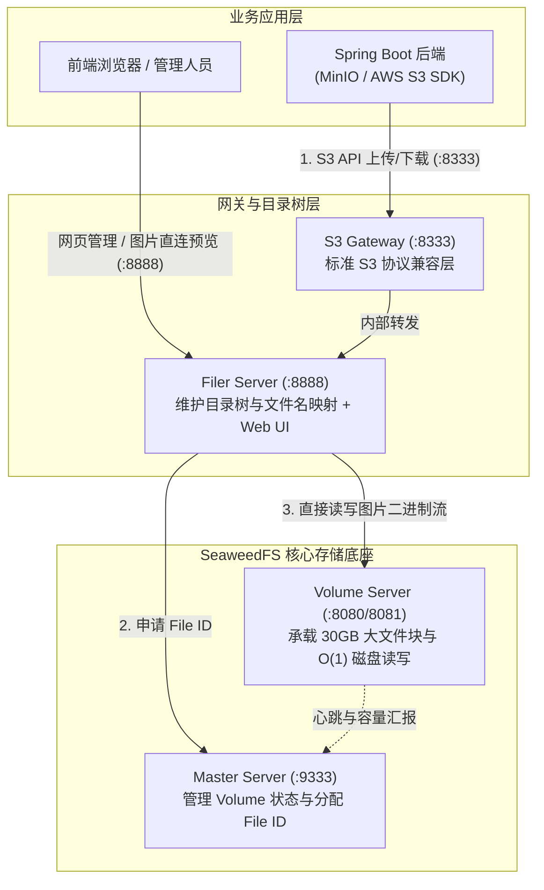
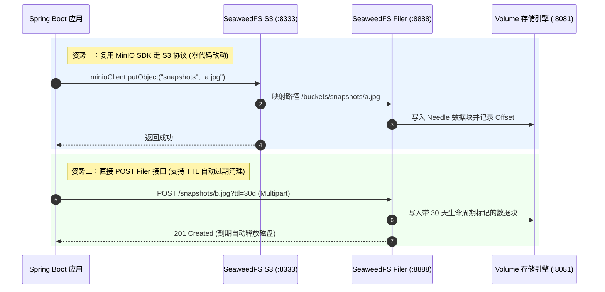

# 告别 MinIO：基于 SeaweedFS 打造高性能本地海量图片存储服务（从原理、三端部署到 Java 实战）

> **摘要：** 随着开源版 MinIO 进入归档停更状态以及 AGPLv3 协议在商业项目交付中的合规风险，寻找一款轻量、高速且协议友好的本地对象存储替代方案已成为刚需。本文将带你全面认识专为海量小文件与图片存储而生的 **SeaweedFS**，通过架构图解、Windows/Ubuntu/Docker 三端极简部署以及 Spring Boot 实战代码，助你在 10 分钟内完成平滑迁移与落地。

---

## 一、 为什么我们需要替换 MinIO？

在企业私有化部署、安防抓拍、工业视觉检测以及常规 Web 业务附件存储场景中，我们通常会面临以下痛点：

1. **MinIO 开源策略转向与协议风险**：MinIO 官方重心已全面转向商业版 AIStor，开源版本不仅砍掉了诸多管理台功能并归档停更，其采用的 **AGPLv3 协议** 对私有化商业交付极不友好。
2. **海量小文件（图片）导致的磁盘性能雪崩**：传统文件系统（Ext4/XFS）和常规对象存储在面对数百万、数千万张几十 KB 到几 MB 的图片时，每一个文件都会占用独立的 `Inode` 和元数据块。这不仅极易导致 **Inode 耗尽（磁盘还有空间却无法写入）**，更会因为频繁的随机磁盘寻道导致读写 IOPS 暴跌。

而 **SeaweedFS** 正是为了彻底解决这一问题而诞生的开源分布式存储系统（采用商业友好的 **Apache 2.0 协议**）。

---

## 二、 初识 SeaweedFS：为什么它存图片这么快？

### 1. 核心原理：Facebook Haystack 论文的工程实现

在传统文件系统中，读取一张图片往往需要先查目录树、再读 Inode 元数据、最后去磁盘寻道读取数据，至少需要 **3 次以上的磁盘 I/O**。

SeaweedFS 换了一个极其巧妙的思路——**“化零为整，顺序追加”**：
* **大块合并（Volume）**：SeaweedFS 预先在磁盘上创建若干个巨大的物理文件（默认每个 Volume 最大 **30GB**）。
* **追加写入（Needle）**：你上传的成千上万张小图片，都会被打包成一个个紧凑的数据块（称为 `Needle`），像串糖葫芦一样直接追加写入（Append-only）到这个 30GB 的 `.dat` 大文件中。
* **$O(1)$ 极速读取**：存储节点在内存中维护一张极简的哈希索引表（每张图片仅消耗 **16 字节** 内存），直接记录图片 ID 到 30GB 大文件中的物理偏移量（`Offset`）和大小（`Size`）。读取任意一张图片，**只需 1 次磁盘寻道（时间复杂度 $O(1)$）**。

#### 📊 图解：传统文件系统 vs SeaweedFS 存储模型

```text
【传统文件系统：百万张图片 = 百万个独立小文件 + 碎片化寻道】
目录树 -> Inode #101 -> [图片1.jpg (64KB)]  (寻道 3 次，消耗 1 个 Inode)
目录树 -> Inode #102 -> [图片2.jpg (80KB)]  (寻道 3 次，消耗 1 个 Inode)
... (文件越多，目录检索越慢，Inode 迅速耗尽)

=========================================================================

【SeaweedFS：百万张图片 = 1 个 30GB 连续大文件 (Volume_1.dat)】
内存哈希表 (16B/张):  Key_01 -> Offset: 0,    Size: 64KB
                     Key_02 -> Offset: 64KB, Size: 80KB
                       │
                       ▼ (仅需 1 次 pread 磁盘寻道，复杂度 O(1)！)
物理磁盘 [Volume_1.dat]: | Needle 1 (图片1) | Needle 2 (图片2) | Needle 3 (图片3) | ---> 顺序追加写入
```

---

### 2. 四大核心组件与架构图

SeaweedFS 将全套功能打包在**单个几十 MB 的可执行文件（`weed`）**中，逻辑上分为四个核心角色：



| 组件名称 | 默认 HTTP 端口 | 默认 gRPC 端口 | 核心职责说明 |
| :--- | :--- | :--- | :--- |
| **Master Server** | `9333` | `19333` | **集群大脑**：不经手具体文件流，只管理 Volume 节点状态并分配全局唯一的 `File ID`。 |
| **Volume Server** | `8080` ⚠️ | `18080` | **存储引擎**：负责将数据追加写入 `.dat` 大文件。*(注：8080 易与 Tomcat 冲突，建议改为 `8081`)* |
| **Filer Server** | `8888` | `18888` | **目录管家**：提供我们熟悉的文件夹树状结构与可视化 Web 界面，将文件名映射到底层 `File ID`。 |
| **S3 Gateway** | `8333` | *无* | **协议网关**：对外提供与 MinIO 完全一致的 S3 接口，原业务代码无需重写。 |

---

## 三、 保姆级部署指南（Windows / Ubuntu / Docker）

SeaweedFS 是用 Go 语言编写的单文件程序，**没有任何外部运行时依赖**。我们可以通过 `weed server` 一体机指令，一条命令同时拉起上述所有服务。

### 准备工作：创建 S3 账号配置文件 `s3.json`
无论使用哪种系统，如果你希望开启 S3 接口的账号密码校验（即 `AccessKey` 和 `SecretKey`），请先准备一个 `s3.json` 文件：

```json
{
  "identities": [
    {
      "name": "admin",
      "credentials": [
        {
          "accessKey": "admin",
          "secretKey": "admin123456"
        }
      ],
      "actions": ["Admin", "Read", "List", "Tagging", "Write"]
    }
  ]
}
```

---

### 方案 A：Windows 本地快速运行（适合本地开发与 Windows Server）

1. **下载安装包**：
   直接点击下载官方 Windows 64位包：[windows_amd64.zip](https://github.com/seaweedfs/seaweedfs/releases/latest/download/windows_amd64.zip)（如果在 GitHub Releases 页面手动找，需点击底部的 `Show all assets` 展开列表）。
2. **组织目录结构**：
   解压出 `weed.exe`，放入 `D:\seaweedfs\` 目录，并在同级创建 `data` 文件夹和 `s3.json`：
   ```text
   D:\seaweedfs\
   ├── weed.exe       (核心程序)
   ├── s3.json        (S3账号配置)
   ├── start.bat      (一键启动脚本)
   └── data\          (新建空文件夹，用于存放图片数据)
   ```
3. **编写 `start.bat` 启动脚本**（避免直接双击 `weed.exe` 闪退）：
   ```bat
   @echo off
   chcp 65001 >nul
   title SeaweedFS All-in-One Server
   echo 正在启动 SeaweedFS (S3端口: 8333, Web文件管理: 8888, Master: 9333)...

   "%~dp0weed.exe" server -ip=127.0.0.1 -dir="%~dp0data" -volume.max=100 -volume.port=8081 -filer -s3 -s3.config="%~dp0s3.json"

   pause
   ```
   > **提示**：这里通过 `-volume.port=8081` 将默认的 8080 端口改为了 8081，防止与本地运行的 Spring Boot 端口冲突！

---

### 方案 B：Ubuntu 生产级 Systemd 后台部署（无 Docker 依赖）

1. **下载并安装二进制文件**：
   ```bash
   sudo mkdir -p /opt/seaweedfs/data /etc/seaweedfs
   cd /opt/seaweedfs

   # 下载最新版本并解压
   wget https://github.com/seaweedfs/seaweedfs/releases/latest/download/linux_amd64.tar.gz
   tar -zxvf linux_amd64.tar.gz
   sudo mv weed /usr/local/bin/
   sudo chmod +x /usr/local/bin/weed
   ```
2. **放入配置文件**：将上文准备好的 `s3.json` 保存至 `/etc/seaweedfs/s3.json`。
3. **配置 Systemd 开机自启服务**：
   ```bash
   sudo tee /etc/systemd/system/seaweedfs.service <<-'EOF'
   [Unit]
   Description=SeaweedFS All-in-One Storage Server
   After=network.target

   [Service]
   Type=simple
   User=root
   WorkingDirectory=/opt/seaweedfs
   ExecStart=/usr/local/bin/weed server \
     -ip=127.0.0.1 \
     -ip.bind=0.0.0.0 \
     -dir=/opt/seaweedfs/data \
     -volume.max=100 \
     -volume.port=8081 \
     -filer \
     -s3 \
     -s3.config=/etc/seaweedfs/s3.json
   Restart=on-failure
   RestartSec=5
   LimitNOFILE=65536

   [Install]
   WantedBy=multi-user.target
   EOF
   ```
4. **启动并验证服务**：
   ```bash
   sudo systemctl daemon-reload
   sudo systemctl enable --now seaweedfs
   sudo systemctl status seaweedfs
   ```

---

### 方案 C：Docker Compose 一键容器化部署

如果你习惯使用 Docker，只需新建以下 `docker-compose.yml` 即可：

```yaml
version: '3.8'

services:
  seaweedfs:
    image: chrislusf/seaweedfs:latest
    container_name: seaweedfs
    restart: always
    ports:
      - "9333:9333" # Master 状态控制台
      - "8888:8888" # Filer Web 文件管理器
      - "8333:8333" # S3 API 端口 (平替 MinIO 9000)
      - "8081:8080" # Volume 端口映射为 8081 避免宿主机 8080 冲突
    volumes:
      - ./data:/data
      - ./s3.json:/etc/seaweedfs/s3.json:ro
    command: >
      server 
      -dir=/data 
      -volume.max=100 
      -filer 
      -s3 
      -s3.config=/etc/seaweedfs/s3.json 
      -ip.bind=0.0.0.0
```

---

### 🖥️ 部署验证与可视化界面预览

服务启动后，你可以直接在浏览器访问以下两个内置控制台：

1. **Filer 网页版文件管理器（`http://127.0.0.1:8888`）**：
   直观展示所有的目录与文件。你通过 S3 接口创建的 Bucket，都会自动出现在 `/buckets/` 目录下，支持在网页上直接**新建目录、拖拽上传图片、点击预览和删除**。
   ```text
   +-----------------------------------------------------------------------+
   |  🌿 SeaweedFS Filer                     [Create Folder] [Upload File] |
   +-----------------------------------------------------------------------+
   |  Path: /buckets/snapshots/2026/10/                                    |
   +-----------------------------------------------------------------------+
   |  Name                          Size        Type         Last Modified |
   |  📁 ..                                                                |
   |  🖼️ cam01_capture_01.jpg       142 KB      image/jpeg   Just now      |
   |  🖼️ avatar_user_99.png         85 KB       image/png    2 mins ago    |
   +-----------------------------------------------------------------------+
   ```
2. **Master 集群监控台（`http://127.0.0.1:9333`）**：
   查看当前已分配的 Volume 数量、磁盘剩余可用容量以及各存储节点的存活状态。

---

## 四、 Java (Spring Boot) 实战对接指南

在 Java 项目中对接 SeaweedFS 有两种主流姿势：**S3 协议无缝平替**（适合老项目零改造迁移）和 **Filer HTTP 直传**（适合轻量级调用及设置图片到期自动清理）。



---

### 姿势一：复用 `minio-java` SDK 无缝对接 S3 端口（8333）

如果你原来的项目使用的就是 MinIO，**完全不需要修改 Maven 依赖**，只需把配置文件里的端口改为 `8333` 即可！

#### 1. 引入 Maven 依赖 (`pom.xml`)
```xml
<dependency>
    <groupId>io.minio</groupId>
    <artifactId>minio</artifactId>
    <version>8.5.7</version>
</dependency>
```

#### 2. 修改配置文件 (`application.yml`)
```yaml
seaweed:
  s3:
    endpoint: http://127.0.0.1:8333
    access-key: admin
    secret-key: admin123456
    bucket-name: snapshots
```

#### 3. 编写上传与获取链接服务类 (`SeaweedS3Service.java`)
```java
package com.example.demo.service;

import io.minio.*;
import io.minio.http.Method;
import jakarta.annotation.PostConstruct;
import org.springframework.beans.factory.annotation.Value;
import org.springframework.stereotype.Service;
import org.springframework.web.multipart.MultipartFile;

import java.io.InputStream;
import java.time.LocalDate;
import java.time.format.DateTimeFormatter;
import java.util.UUID;
import java.util.concurrent.TimeUnit;

@Service
public class SeaweedS3Service {

    @Value("${seaweed.s3.endpoint}")
    private String endpoint;

    @Value("${seaweed.s3.access-key}")
    private String accessKey;

    @Value("${seaweed.s3.secret-key}")
    private String secretKey;

    @Value("${seaweed.s3.bucket-name}")
    private String bucketName;

    private MinioClient minioClient;

    @PostConstruct
    public void init() {
        this.minioClient = MinioClient.builder()
                .endpoint(endpoint)
                .credentials(accessKey, secretKey)
                .build();
    }

    /**
     * 上传图片并返回存储相对路径
     */
    public String uploadImage(MultipartFile file) throws Exception {
        // 1. 确保存储桶存在
        boolean exists = minioClient.bucketExists(BucketExistsArgs.builder().bucket(bucketName).build());
        if (!exists) {
            minioClient.makeBucket(MakeBucketArgs.builder().bucket(bucketName).build());
        }

        // 2. 生成按日期归档的文件名: 2026/10/20/uuid.jpg
        String originalName = file.getOriginalFilename();
        String ext = (originalName != null && originalName.contains("."))
                ? originalName.substring(originalName.lastIndexOf(".")) : ".jpg";
        String objectName = LocalDate.now().format(DateTimeFormatter.ofPattern("yyyy/MM/dd"))
                + "/" + UUID.randomUUID().toString().replace("-", "") + ext;

        // 3. 流式上传至 SeaweedFS S3 网关
        try (InputStream is = file.getInputStream()) {
            minioClient.putObject(
                    PutObjectArgs.builder()
                            .bucket(bucketName)
                            .object(objectName)
                            .stream(is, file.getSize(), -1)
                            .contentType(file.getContentType() != null ? file.getContentType() : "image/jpeg")
                            .build()
            );
        }

        return objectName;
    }

    /**
     * 生成带有效期的签名预览地址 (适用于私有访问)
     */
    public String getPresignedUrl(String objectName) throws Exception {
        return minioClient.getPresignedObjectUrl(
                GetPresignedObjectUrlArgs.builder()
                        .method(Method.GET)
                        .bucket(bucketName)
                        .object(objectName)
                        .expiry(2, TimeUnit.HOURS)
                        .build()
        );
    }
}
```

---

### 姿势二：使用 Spring `RestTemplate` 直传 Filer 端口（8888）

如果你不想引入第三方 SDK，或者需要用到 SeaweedFS 的杀手锏功能——**TTL 自动过期清理**，可以直接向 `8888` 端口发送 HTTP Multipart 请求：

```java
package com.example.demo.service;

import org.springframework.core.io.ByteArrayResource;
import org.springframework.http.*;
import org.springframework.stereotype.Service;
import org.springframework.util.LinkedMultiValueMap;
import org.springframework.util.MultiValueMap;
import org.springframework.web.client.RestTemplate;

@Service
public class SeaweedFilerService {

    private final RestTemplate restTemplate = new RestTemplate();
    private static final String FILER_ENDPOINT = "http://127.0.0.1:8888";

    /**
     * 上传图片字节数组并指定 TTL 过期时间
     *
     * @param imageBytes 图片字节流
     * @param targetPath 存储路径，如 "/buckets/snapshots/2026/10/temp_01.jpg"
     * @param ttl        自动清理周期，如 "30d"(30天)、"24h"(24小时)，传 null 则永久保存
     * @return 浏览器可直接预览的 URL
     */
    public String uploadWithTtl(byte[] imageBytes, String targetPath, String ttl) {
        String url = FILER_ENDPOINT + targetPath + (ttl != null ? "?ttl=" + ttl : "");

        HttpHeaders headers = new HttpHeaders();
        headers.setContentType(MediaType.MULTIPART_FORM_DATA);

        MultiValueMap<String, Object> body = new LinkedMultiValueMap<>();
        ByteArrayResource resource = new ByteArrayResource(imageBytes) {
            @Override
            public String getFilename() {
                return targetPath.substring(targetPath.lastIndexOf("/") + 1);
            }
        };
        body.add("file", resource);

        HttpEntity<MultiValueMap<String, Object>> entity = new HttpEntity<>(body, headers);
        ResponseEntity<String> response = restTemplate.postForEntity(url, entity, String.class);

        if (response.getStatusCode().is2xxSuccessful()) {
            return FILER_ENDPOINT + targetPath;
        }
        throw new RuntimeException("图片上传失败: " + response.getBody());
    }
}
```

---

## 五、 进阶彩蛋：两大超实用内置特性

### 1. URL 动态实时生成缩略图（免去前端加载大图卡顿）
在列表页展示抓拍图或相册时，如果直接加载几 MB 的原图会严重拖慢页面。SeaweedFS 原生支持在访问 URL 后直接追加宽高参数，服务端会自动实时裁剪压缩并返回：

* **访问原图**：
  `http://127.0.0.1:8888/buckets/snapshots/2026/10/20/test.jpg`
* **动态获取 200x200 缩略图**：
  `http://127.0.0.1:8888/buckets/snapshots/2026/10/20/test.jpg?width=200&height=200`
* **等比例适应裁剪**：
  `http://127.0.0.1:8888/buckets/snapshots/2026/10/20/test.jpg?width=200&height=200&mode=fit`

### 2. TTL 生命周期单位速查表
在通过 Filer 上传监控抓拍或临时凭证图片时，只需在 URL 尾部附带 `?ttl=xxx`，到期后底层 Volume 会自动回收空间，再也不用写 `Cron` 定时任务去扫库删文件：
* `m`：分钟（如 `ttl=30m`）
* `h`：小时（如 `ttl=12h`）
* `d`：天（如 `ttl=30d`，最常用于保留 30 天内的抓拍图）
* `w`：周（如 `ttl=4w`）
* `M`：月（如 `ttl=6M`）
* `y`：年（如 `ttl=1y`）

---

## 六、 总结

| 对比维度 | 传统 MinIO | SeaweedFS |
| :--- | :--- | :--- |
| **开源协议** | AGPLv3（商业闭源交付有传染风险） | **Apache 2.0（商业极其友好）** |
| **社区维护状态** | 开源仓库已归档停更 | 社区极度活跃，持续高频迭代 |
| **百万级小图片读写** | 易产生大量元数据碎片，IOPS 下降明显 | **Haystack 大块合并，$O(1)$ 单次磁盘寻道** |
| **资源占用与部署** | 较高 | 单二进制文件，内存占用仅几十 MB，三端通吃 |
| **代码迁移成本** | - | **零成本（直接兼容 MinIO SDK 与 S3 接口）** |

通过本文的梳理，相信你已经掌握了 SeaweedFS 从底层原理、跨平台部署到 Java 代码对接的完整链路。无论是新项目技术选型，还是老项目的 MinIO 替换，SeaweedFS 都是当前本地化图片存储的最佳拍档。
