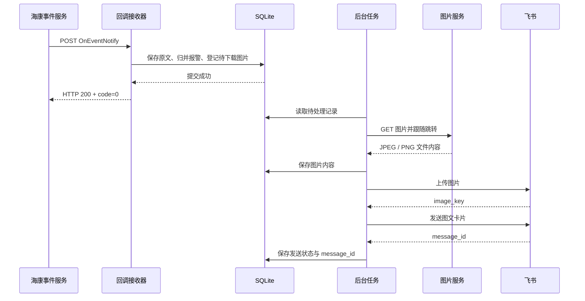
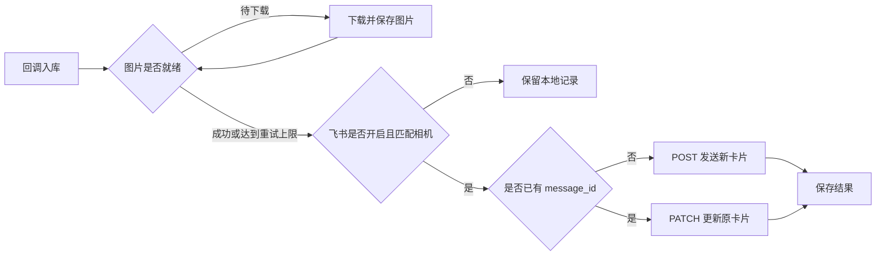

垃圾房热成像相机触发温度报警后，接收系统需要拿到**相机名称、发生时间、温度、阈值和现场图片**，再通过飞书应用机器人发送图文消息。

本文用 Python 标准库、SQLite 和一个管理页面完成对接。数据来自报警事件；相机触发规则时上报，不做定时温度采样。下文 IP、设备编码与凭据均使用示例值。


## 一、先明确各个系统的职责

| 系统 | 职责 |
| --- | --- |
| 热成像相机 | 执行测温规则，产生温度报警和抓图 |
| 海康平台 | 提供 OpenAPI、分发事件、保存报警图片 |
| 接收系统 | 接收回调、归并报警、下载图片、记录推送状态 |
| SQLite | 保存配置、原始事件、图片文件内容和飞书消息 ID |
| 飞书应用机器人 | 上传图片，发送或更新图文卡片 |

图片必须经过接收服务器：**下载海康图片 → 上传飞书 → 取得 `image_key` → 发送卡片**。不能把海康内网图片 URL 直接填进飞书卡片，期待飞书代为访问。

完整示例：[下载源码 ZIP](/examples/hik-temperature.zip)。解压后可直接启动，文章中的代码片段对应包内实现。

## 二、准备配置与网络

### 1. 海康和飞书配置

| 配置 | 示例 | 获取方式 |
| --- | --- | --- |
| 海康 API 网关 | `https://10.20.0.10:442` | 平台管理员提供 |
| 海康 AppKey / AppSecret | 环境对应的合作方凭据 | 在开放平台创建合作方并授权 |
| 热成像监控点编码 | `camera_thermal_01` | 通过监控点查询接口获取 |
| 回调地址 | `http://10.20.0.40:8769/callback/<接收标识>` | 接收程序生成 |
| 飞书 App ID / App Secret | `cli_example` / `<APP_SECRET>` | 飞书自建应用控制台 |
| 接收人类型与 ID | `chat_id` / `oc_example` | 目标群聊 ID；机器人需加入群聊 |

海康需要分别授权：监控点查询、事件订阅、订阅查询、取消订阅、视频事件图片接口，并给合作方关联用户分配相机资源权限。`0x02401008 Unauthorized Consumer!` 应核对当前调用接口的授权。

飞书应用开启机器人能力，配置应用发送消息和图片资源相关权限，完成发布。发给个人时，还需将接收人纳入应用可用范围。

### 2. 网络放行方向

| 来源 | 目标 | 用途 |
| --- | --- | --- |
| 海康事件推送节点、管理电脑 | 接收服务器 TCP 8769 | 回调和管理页面 |
| 接收服务器 | 海康网关 TCP 442 | 查询相机、管理订阅、换取图片地址 |
| 接收服务器 | 图片入口 TCP 6120 | 获取图片，可能返回跳转 |
| 接收服务器 | 图片存储节点 TCP 6501 | 下载跳转后的实际文件 |
| 接收服务器 | `open.feishu.cn:443` | 取令牌、上传图片和发消息 |

图片入口和存储节点由回调 URL、HTTP `Location` 决定；6120、6501 是本文示例中的端口。

## 三、海康接口：查询相机、订阅和取消

海康请求采用 **POST + JSON + AK/SK 签名**。下列路径统一拼接到 API 网关地址后。

| 操作 | 路径 |
| --- | --- |
| 查询监控点 | `/artemis/api/resource/v2/camera/search` |
| 订阅事件 | `/artemis/api/eventService/v1/eventSubscriptionByEventTypes` |
| 查询订阅 | `/artemis/api/eventService/v1/eventSubscriptionView` |
| 取消订阅 | `/artemis/api/eventService/v1/eventUnSubscriptionByEventTypes` |
| 相对图片 URI 换取下载地址 | `/artemis/api/video/v1/events/picture` |

### 1. AK/SK 签名核心代码

签名放在请求头中，`AppSecret` 不放进 URL 或业务 JSON。下面使用 HMAC-SHA256，签名头按小写名称排序；此实现不发送 `Content-MD5` 和 `Date`。

```python
import base64
import hashlib
import hmac
import json
import time
import uuid

from server import remote


def signed_headers(app_key, app_secret, path):
    headers = {
        "Accept": "application/json",
        "Content-Type": "application/json",
        "X-Ca-Key": app_key,
        "X-Ca-Nonce": str(uuid.uuid4()),
        "X-Ca-Timestamp": str(int(time.time() * 1000)),
    }
    signing = {k.lower(): v for k, v in headers.items()
               if k.startswith("X-Ca-")}
    names = sorted(signing)
    canonical = "POST\napplication/json\napplication/json\n"
    canonical += "".join(f"{k}:{signing[k]}\n" for k in names) + path
    signature = hmac.new(
        app_secret.encode(), canonical.encode(), hashlib.sha256
    ).digest()
    headers["X-Ca-Signature-Headers"] = ",".join(names)
    headers["X-Ca-Signature"] = base64.b64encode(signature).decode()
    return headers


def hik_post(base, app_key, app_secret, path, body):
    raw, _ = remote(
        base.rstrip("/") + path,
        json.dumps(body, ensure_ascii=False).encode(),
        signed_headers(app_key, app_secret, path),
    )
    result = json.loads(raw)
    if str(result.get("code")) != "0":
        raise ValueError(f"海康接口失败：{result.get('code')}")
    return result
```

`remote` 是配套源码里的 HTTP 封装，负责证书校验、超时、响应大小和错误处理。

### 2. 查询热成像相机的平台编码

请求 `POST /artemis/api/resource/v2/camera/search`：

```json
{
  "name": "垃圾房",
  "pageNo": 1,
  "pageSize": 20
}
```

需要缩小范围时，再增加 `regionIndexCodes` 和 `isSubRegion`。精简返回：

```json
{
  "code": "0",
  "msg": "success",
  "data": {
    "total": 1,
    "list": [
      {
        "indexCode": "camera_thermal_01",
        "externalIndexCode": "<国标编码>",
        "name": "垃圾房防火监控（热成像）",
        "chanNum": 2
      }
    ]
  }
}
```

保存 `indexCode`，后续与回调中的 `srcIndex` 或 `targetAttrs.cameraIndexCode` 匹配。`externalIndexCode` 是国标编码，不能替代平台编码。

### 3. 订阅温度报警

请求 `POST /artemis/api/eventService/v1/eventSubscriptionByEventTypes`：

```json
{
  "eventTypes": [192517],
  "eventDest": "http://10.20.0.40:8769/callback/demo-receiver",
  "subType": 0
}
```

返回：

```json
{"code": "0", "msg": "success"}
```

本文选择 `subType=0` 接收设备原始事件；`1` 为平台联动事件，`2` 为两者。需要温差报警时，将 `192518` 加入 `eventTypes`。

**订阅接口没有相机筛选参数。** 接收系统仍需按监控点编码过滤。`eventDest` 应使用页面生成的完整地址；订阅成功表示平台接受了配置，真实事件随后才会投递。

### 4. 查询当前订阅

请求 `POST /artemis/api/eventService/v1/eventSubscriptionView`，请求体为 `{}`。返回示例：

```json
{
  "code": "0",
  "msg": "OK",
  "data": {
    "detail": [
      {
        "eventDest": "http://10.20.0.40:8769/callback/demo-receiver",
        "eventTypes": [192517]
      }
    ]
  }
}
```

结果只有接收地址和事件类型，没有订阅人或相机信息，不能据此判断全平台是否还有其他合作方订阅。

### 5. 取消订阅

请求 `POST /artemis/api/eventService/v1/eventUnSubscriptionByEventTypes`：

```json
{"eventTypes": [192517]}
```

成功返回：

```json
{"code": "0", "msg": "success"}
```

该接口按事件类型取消，不能传入相机编码或只指定某个回调地址。管理页面在提交前查询列表、展示影响范围并核对快照，避免误操作其他同类订阅。

## 四、接收真实报警，先入库再下载

海康向 `eventDest` 发送 `OnEventNotify`，一次请求的 `events` 数组可以包含多条事件。下面保留一条温度报警的核心字段：

```json
{
  "method": "OnEventNotify",
  "params": {
    "events": [
      {
        "eventId": "alarm-20261022-001",
        "eventType": 192517,
        "happenTime": "2026-10-22T08:32:37.723+08:00",
        "srcIndex": "camera_thermal_01",
        "srcName": "垃圾房防火监控（热成像）",
        "status": 0,
        "data": {
          "dataType": "thermalImaging",
          "thermometry": [
            {
              "ruleId": 0,
              "curTemperature": "76.3",
              "ruleTemperature": "70",
              "thermometryUnit": 0,
              "alarmLevel": 0,
              "imageUrl": "http://172.17.8.23:6120/pic?<热成像图片标识>",
              "visiblePicUrl": "http://172.17.8.23:6120/pic?<可见光图片标识>",
              "targetAttrs": {
                "cameraIndexCode": "camera_thermal_01",
                "imageServerCode": "image_server_01",
                "picServerIndexCode": "image_server_01"
              }
            }
          ]
        }
      }
    ]
  }
}
```

| 字段 | 用途 |
| --- | --- |
| `eventId` + `eventType` + 相机编码 | 归并同一报警的重复投递、状态更新和补图 |
| `happenTime` | 事件发生时间，保留原始时区偏移 |
| `curTemperature` / `ruleTemperature` | 当前温度 / 规则阈值 |
| `thermometryUnit` | 本例 `0` 表示摄氏度 |
| `imageUrl` / `visiblePicUrl` | 热成像图 / 可见光图 |
| `targetAttrs.imageServerCode` | 相对 URI 换取地址时使用的图片服务器编码 |

这条报文实际使用 `curTemperature`，不能只按旧文档中的 `curTemperatureDiff` 读取。`alarmLevel` 是设备告警标记，不直接当作平台事件等级。地点、平台等级不存在时，消息中直接省略。

回调核心逻辑如下；HTTP 层在函数返回后应答 `200`：

```python
from datetime import datetime, timezone
from server import encode


def save_callback(store, payload):
    params = payload.get("params")
    if payload.get("method") != "OnEventNotify" or not isinstance(params, dict):
        raise ValueError("需要 OnEventNotify 和 params.events")
    events = params.get("events")
    if not isinstance(events, list) or not events:
        raise ValueError("events 必须为非空数组")
    if any(not isinstance(event, dict) for event in events):
        raise ValueError("events 中的元素必须为对象")

    received = datetime.now(timezone.utc).isoformat()
    with store.connect() as db:
        db.execute(
            "INSERT INTO messages(received,payload) VALUES (?,?)",
            (received, encode(payload).decode()),
        )
        store.ingest(db, payload, received)
    return {"code": "0", "msg": "success"}
```

事务成功后立即应答。图片下载和飞书调用由后台线程执行，避免外部网络请求阻塞海康回调。



## 五、图片下载：完整 URL、相对 URI 和 301 跳转

### 1. 完整 URL 直接下载

本例 `imageUrl` 已经是完整 HTTP 地址。请求只需要 GET，取得文件内容；不附加海康 AppSecret 或飞书令牌。

图片入口可能返回：

```http
HTTP/1.1 301 Moved Permanently
Location: http://172.17.8.26:6501/<实际图片地址>
```

跟随跳转后，实际文件响应为：

```http
HTTP/1.1 200 OK
Content-Type: image/jpeg
Content-Length: 183106

<JPEG 二进制内容>
```

本次排查中，HTTP 客户端禁止了所有跳转，导致图片入口可访问，程序仍无法下载。修复时，只为图片 GET 开启有限跳转，接口签名请求继续使用原地址。

配套程序的关键处理：

```python
from urllib.parse import urlsplit
from urllib.request import HTTPRedirectHandler, Request


class ImageRedirect(HTTPRedirectHandler):
    max_redirections = 3
    max_repeats = 2

    def redirect_request(self, req, fp, code, msg, headers, newurl):
        target = urlsplit(newurl)
        if req.get_method() != "GET":
            raise ValueError("只允许图片 GET 跟随跳转")
        if target.scheme not in ("http", "https") or not target.hostname:
            raise ValueError("无效的图片跳转地址")
        if target.username or target.password:
            raise ValueError("图片跳转地址不能包含账号密码")
        if req.full_url.startswith("https:") and target.scheme == "http":
            raise ValueError("图片跳转不能将 HTTPS 降为 HTTP")
        return Request(newurl, headers={"Accept": "image/*"}, method="GET")
```

下载时使用这条路径：

```python
from server import remote

image_bytes, mime = remote(
    image_url,
    headers={"Accept": "image/*"},
    follow_redirects=True,
    limit=10 * 1024 * 1024,
)
```

程序还会校验 JPEG、PNG、GIF、WebP 的文件头。图片服务返回 `application/octet-stream` 时，可通过文件头识别实际格式；HTML 错误页不会作为图片上传。

### 2. 相对 URI 先换取下载地址

如果回调只给出 `/pic?...`，调用海康视频事件图片接口：

```http
POST /artemis/api/video/v1/events/picture
Content-Type: application/json
X-Ca-Key: <APP_KEY>
X-Ca-Signature: <计算得到的签名>
```

```json
{
  "svrIndexCode": "image_server_01",
  "picUri": "/pic?<图片标识>",
  "netProtocol": "http"
}
```

返回：

```json
{
  "code": "0",
  "msg": "success",
  "data": {
    "picUrl": "http://172.17.8.23:6120/pic?<下载标识>"
  }
}
```

随后 GET 下载 `data.picUrl`。完整 URL 失效且携带图片服务器编码时，也可按相对 URI 重新换取地址。字段和调用方式见[海康官方视频图片接口](https://open.hikvision.com/docs/16741aecc05944a6b0cd1341d68e4546)。

## 六、飞书：上传文件，再发送卡片

### 1. 获取应用令牌

```http
POST https://open.feishu.cn/open-apis/auth/v3/tenant_access_token/internal
Content-Type: application/json
```

```json
{"app_id": "cli_example", "app_secret": "<APP_SECRET>"}
```

返回：

```json
{
  "code": 0,
  "msg": "ok",
  "tenant_access_token": "<TENANT_ACCESS_TOKEN>",
  "expire": 7200
}
```

按返回有效期缓存令牌，提前约两分钟刷新，避免每条报警都重新获取。

### 2. 上传报警图片

```http
POST https://open.feishu.cn/open-apis/im/v1/images
Authorization: Bearer <TENANT_ACCESS_TOKEN>
Content-Type: multipart/form-data; boundary=<BOUNDARY>
```

表单字段：

| 字段 | 内容 |
| --- | --- |
| `image_type` | `message` |
| `image` | 已下载的图片文件内容 |

成功返回：

```json
{
  "code": 0,
  "msg": "success",
  "data": {"image_key": "img_example"}
}
```

使用配套类可复用令牌和图片缓存：

```python
from feishu import Feishu
from server import remote

bot = Feishu(remote)
token = bot.tenant_token(feishu_config)
image_key = bot.upload(feishu_config, token, {
    "content": image_bytes,
    "mime": mime,
    "label": "热成像图",
})
```

`upload()` 内部构造的核心表单是：

```python
import secrets

boundary = "----Thermal" + secrets.token_hex(16)
multipart = (
    f'--{boundary}\r\n'
    'Content-Disposition: form-data; name="image_type"\r\n\r\n'
    'message\r\n'
    f'--{boundary}\r\n'
    'Content-Disposition: form-data; name="image"; filename="alarm.jpg"\r\n'
    'Content-Type: image/jpeg\r\n\r\n'
).encode() + image_bytes + f'\r\n--{boundary}--\r\n'.encode()
```

热成像图和可见光图分别上传，得到各自的 `image_key`。[飞书上传图片接口](https://open.feishu.cn/document/server-docs/im-v1/image/create)

### 3. 发送图文卡片

请求：

```http
POST https://open.feishu.cn/open-apis/im/v1/messages?receive_id_type=chat_id
Authorization: Bearer <TENANT_ACCESS_TOKEN>
Content-Type: application/json
```

发送代码中，`content` 是 **JSON 字符串**：

```python
import json
import uuid
from feishu import make_card

card = make_card(alarm, [
    ("热成像图", thermal_image_key),
    ("可见光图", visible_image_key),
])
body = {
    "receive_id": "oc_example",
    "msg_type": "interactive",
    "content": json.dumps(card, ensure_ascii=False),
    "uuid": str(uuid.uuid4()),
}
```

`make_card()` 生成的内容结构：

```json
{
  "config": {"wide_screen_mode": true, "update_multi": true},
  "header": {
    "template": "grey",
    "title": {"tag": "plain_text", "content": "温度报警"}
  },
  "elements": [
    {
      "tag": "div",
      "text": {
        "tag": "plain_text",
        "content": "事件来源：垃圾房防火监控（热成像）\n发生时间：2026-10-22T08:32:37.723+08:00\n温度：76.3℃\n报警阈值：70℃"
      }
    },
    {
      "tag": "img",
      "img_key": "img_thermal_example",
      "alt": {"tag": "plain_text", "content": "热成像图"},
      "mode": "fit_horizontal",
      "preview": true
    }
  ]
}
```

返回中的 `message_id` 要保存下来：

```json
{
  "code": 0,
  "msg": "success",
  "data": {"message_id": "om_example"}
}
```


### 4. 补图时更新已有卡片

同一报警后续可能补充图片或更新状态。已经发送成功时，使用原 `message_id` 更新卡片：

```http
PATCH https://open.feishu.cn/open-apis/im/v1/messages/om_example
Authorization: Bearer <TENANT_ACCESS_TOKEN>
Content-Type: application/json
```

请求体为 `{"content":"<更新后卡片的 JSON 字符串>"}`，成功响应的 `code` 为 `0`。完整发送接口见[飞书发送消息文档](https://open.feishu.cn/document/server-docs/im-v1/message/create)。

## 七、SQLite 与后台任务如何配合

| 表 | 保存内容 |
| --- | --- |
| `settings` | 海康配置、相机选择、回调地址、飞书配置和推送开关 |
| `messages` | 每次回调原文与接收时间 |
| `alarms` | 归并后的报警、待发送状态、重试次数和 `message_id` |
| `images` | 原始图片 URI、服务器编码、下载状态和图片 BLOB |

同一报警用“相机编码 + 事件类型 + 事件 ID”计算摘要作为唯一键；回调原文全部保留。无事件 ID 时按原报文摘要去重。



程序使用一个后台线程，图片下载和飞书发送各最多自动尝试三次。图片失败时仍可发送文字卡片，具体错误在接收页面查看；修复网络后点击“重新获取图片”，即可补图更新。

关闭飞书推送后继续接收和归档；再次开启不会自动补发关闭期间的记录。配置保存在 SQLite 中，页面读取只返回密钥是否已保存。数据库文件包含密钥，Ubuntu 上设置为 `600`，备份时一并保护。

## 八、启动系统并完成第一次联调

### 1. Windows 本机启动

在解压目录执行：

```powershell
python server.py
```

打开 `http://127.0.0.1:8769`。

### 2. Ubuntu 服务器启动

Python 需要 3.10 或以上，程序不依赖第三方 Python 包：

```bash
python3 --version
export HIK_WORKBENCH_ADMIN_TOKEN="$(python3 -c 'import secrets; print(secrets.token_urlsafe(32))')"
echo "管理口令：$HIK_WORKBENCH_ADMIN_TOKEN"

python3 server.py \
  --port 8769 \
  --public-url http://10.20.0.40:8769 \
  --admin-token-env HIK_WORKBENCH_ADMIN_TOKEN
```

通过 `http://10.20.0.40:8769` 登录。HTTPS 海康网关需要内部 CA 时，加 `--ca-file /path/to/hik-ca.pem`。

配套包提供 `deploy/hik-temperature.service`，持续运行时可交给 systemd；启动参数中的地址、程序目录和数据目录按服务器实际部署位置填写。

### 3. 按顺序验证

1. 填写海康密钥，查询并选择热成像相机，保存配置。
2. 填写飞书应用与接收人，保存后点击“发送飞书测试”，确认文字和内置测试图片都能收到。
3. 在海康实际推送节点上检查回调地址能否访问。
4. 查询现有订阅，核对完整回调地址，再订阅 `192517`。
5. 由现场触发真实报警，核对事件入库、图片预览和飞书通知。

检查回调入口时可以发送空对象，不会插入报警记录：

```bash
curl --noproxy '*' -i --connect-timeout 5 \
  -X POST 'http://10.20.0.40:8769/callback/<页面生成的接收标识>' \
  -H 'Content-Type: application/json' \
  --data '{}'
```

返回 `HTTP 400` 和报文格式错误，说明请求已到达接收程序。这与调用飞书接口产生的 HTTP 400 是两个不同环节，排查时先看错误发生在哪一步。

## 九、图片获取失败的排查顺序

### 1. 在接收服务器测试两个实际目标

```bash
python3 - <<'PY'
import socket
for host, port in [('172.17.8.23', 6120), ('172.17.8.26', 6501)]:
    try:
        with socket.create_connection((host, port), timeout=5):
            print(f'{host}:{port} OK')
    except OSError as error:
        print(f'{host}:{port} FAIL: {error}')
PY
```

如果 UFW 限制出站，放行接收服务器到这两个地址的访问：

```bash
sudo ufw status verbose
sudo ufw allow out to 172.17.8.23 port 6120 proto tcp
sudo ufw allow out to 172.17.8.26 port 6501 proto tcp
```

### 2. UFW 未启用仍然 No route to host

继续检查：

```bash
ip route get 172.17.8.23
ip route get 172.17.8.26
```

这类故障可能出现如下输出：

```text
172.17.8.26 dev br-a1b2c3d4e5f6 src 172.17.0.1
```

数据包被送进 Docker 网桥，而不是公司的内网网卡。原因是 Docker 网络与设备网段重叠，继续添加端口放行规则不能改变这条错误路由。


先定位网络和使用它的容器：

```bash
sudo docker network inspect a1b2c3d4e5f6
sudo docker ps -a --filter network=a1b2c3d4e5f6
```

若由 Compose 管理，在对应网络的 IPAM 中选择经过确认、不与业务网络重叠的子网。例如：

```yaml
networks:
  default:
    ipam:
      config:
        - subnet: 10.250.10.0/24
```

`10.250.10.0/24` 是配置示例，实际使用前需确认空闲。修改后，在项目目录重建网络及关联容器；该操作会中断该项目，业务数据应已放在挂载目录或命名卷中：

```bash
sudo docker compose config --quiet
sudo docker compose down
sudo docker compose up -d
```

重新执行 `ip route get`，确认两个目标改为走正常的内网网卡，再测试端口。Compose 自定义子网的配置见[官方 IPAM 文档](https://docs.docker.com/reference/compose-file/networks/#ipam)。

### 3. 按失败环节处理

| 现象 | 检查位置 |
| --- | --- |
| 回调没有记录 | 事件是否触发、订阅地址、海康推送节点到 8769 的网络 |
| 图片返回 301/302 | 是否跟随跳转，以及跳转目标是否可达 |
| 图片返回 401/403/404/410 | 地址有效性、图片保留时间、是否能重新换取下载地址 |
| 图片地址换取失败 | `svrIndexCode`、`picUri` 和视频事件图片接口授权 |
| 飞书获取令牌失败 | 应用 ID、Secret 和 API 地址 |
| 飞书上传图片失败 | 机器人能力、图片资源权限和文件格式 |
| 飞书发送消息失败 | 接收人类型、群 ID、机器人是否入群、应用可用范围 |

保留具体环节、HTTP 状态和业务错误码。例如 `飞书上传图片失败（HTTP 400，错误码 234007）`，可以直接定位到应用机器人能力，而不是回头排查海康回调。

## 配套源码

| 文件 | 职责 |
| --- | --- |
| `server.py` | HTTP 管理、AK/SK 签名、海康接口、回调接收 |
| `event_store.py` | SQLite 配置、原文保存、事件归并和字段提取 |
| `delivery.py` | 后台图片下载、有限重试和发送队列 |
| `feishu.py` | 令牌缓存、图片上传、卡片创建和更新 |
| `index.html` / `workbench.js` | 配置保存、事件预览、订阅管理和测试推送 |

[下载完整示例](/examples/hik-temperature.zip)，在目录中执行 `python3 -m unittest -v test_server.py test_delivery.py` 可验证签名、回调、图片跳转、字段提取和推送重试等逻辑。
