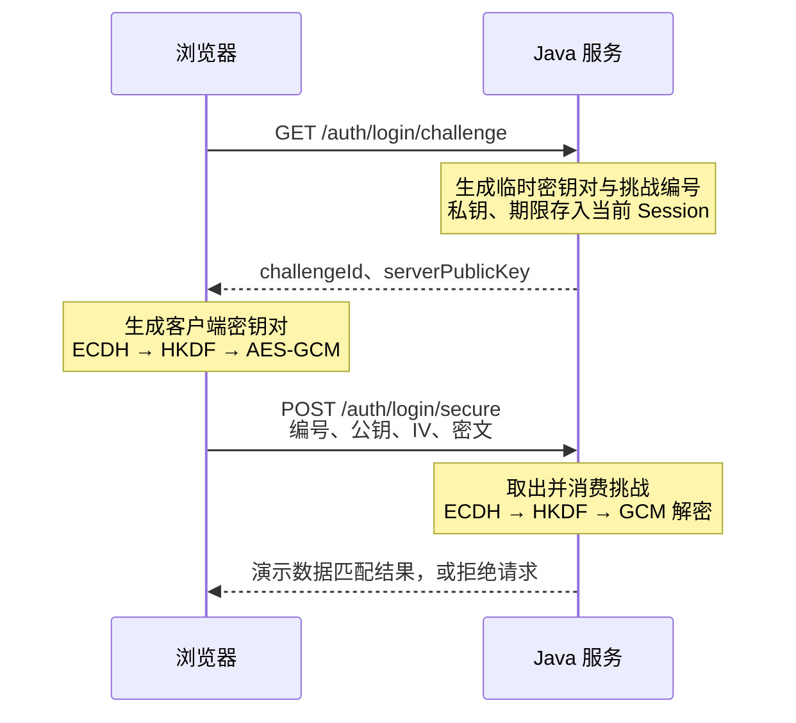

一个登录请求通常是这样的。下面全部使用虚构数据：

```json
{
  "username": "reader_demo",
  "password": "DemoOnly!2026",
  "captchaId": "11111111111111111111111111111111",
  "captchaAnswer": "A2B3C"
}
```

要保护这份数据，首先需要一条 HTTPS 连接。TLS 会加密连接中的数据，并通过证书验证服务器身份。浏览器开发者工具仍能看到请求正文，因为它展示的是浏览器自己发送的数据；这里能看到密码，不等于网络中传输的是明文。

有些系统还会把 JSON 加密后再放进请求体。这会让只接触请求正文、没有解密密钥的环节看到密文，但要多处理密钥、有效期和失败恢复。它适合有额外正文保护需求的场景，不能替代 HTTPS，也防不住已经被控制的网页脚本或后端。

本文从 AES 加密一条消息开始，再解释 RSA-OAEP 和 ECDH 怎样解决密钥问题，最后把浏览器和 Java 接起来。前三个代码实验可以直接运行，不需要下载示例工程。

## 1. 先理解 AES：用同一把密钥加密和解密

**AES 是对称加密算法。** “对称”表示加密方和解密方持有同一把秘密密钥。假设浏览器用密钥 K 把登录 JSON 变成密文，服务器也必须拿到 K，才能恢复 JSON。

这里的密钥和用户密码是两个东西。用户密码需要让服务器验证账号身份；AES 密钥是程序随机生成的字节，用来保护这次传输。AES-256 的“256”表示密钥有 256 位，也就是 32 字节，不是要求用户输入 256 位密码。

AES 还需要选择工作模式。本文使用 **GCM（Galois/Counter Mode）**，它在加密时产生认证标签，在解密时检查数据有没有被改动。

一次 AES-GCM 操作会遇到四个参数：

| 参数 | 含义 | 本文的用法 |
|---|---|---|
| key | 只有通信双方持有的秘密密钥 | 随机生成或通过协商派生，32 字节 |
| IV | 每次加密使用的初始值，也称 nonce | 随机生成 12 字节，可随密文发送；同一密钥下不能重复 |
| AAD | 需要一起校验、但不加密的附加数据 | 绑定本次请求编号；两端必须完全一致 |
| tag | 认证标签，由加密运算产生 | 使用 128 位，即 16 字节；解密时由库检查 |

比如给这次请求编号 `request-001`，把它作为 AAD。服务器解密时也要提供 `request-001`；如果有人把编号改成 `request-002`，即使密文未变，校验也会失败。AAD 可以公开，它的作用是把密文和上下文绑定起来。

### 一个可以直接运行的 AES-GCM 实验

在本页或其他可信的 HTTPS 页面打开浏览器开发者工具的 Console，运行下面整段代码；本机 `http://localhost` 页面也可以。代码只处理字符串 `hello`，不发送网络请求。后面的 RSA、ECDH 实验使用同样的运行方式。

```js
(async () => {
  const utf8 = new TextEncoder();
  const key = await crypto.subtle.generateKey(
    { name: 'AES-GCM', length: 256 }, false, ['encrypt', 'decrypt']
  );
  const params = {
    name: 'AES-GCM',
    iv: crypto.getRandomValues(new Uint8Array(12)),
    additionalData: utf8.encode('request-001'),
    tagLength: 128
  };
  const plaintext = utf8.encode('hello');
  const encrypted = await crypto.subtle.encrypt(params, key, plaintext);
  const restored = await crypto.subtle.decrypt(params, key, encrypted);
  console.log('解密结果：', new TextDecoder().decode(restored));
  console.log('明文字节 / 密文含标签字节：', plaintext.length, encrypted.byteLength);

  const changed = new Uint8Array(encrypted.slice(0));
  changed[0] ^= 1;
  try {
    await crypto.subtle.decrypt(params, key, changed);
    console.log('异常：被修改的数据竟然通过了校验');
  } catch {
    console.log('篡改结果：拒绝解密');
  }
})();
```

预期输出是 `hello`、`5 21` 和“拒绝解密”。`hello` 占 5 字节；Web Crypto 返回的结果已经把 16 字节标签接在密文后面，所以总长是 21 字节。

代码中的 `false` 表示不允许直接导出密钥原始字节；`['encrypt', 'decrypt']` 限定它可以执行的操作。`TextEncoder` 把字符串转换成 UTF-8 字节，因为加密 API 接收字节。`changed[0] ^= 1` 只翻转一个比特，用来观察 GCM 是否会拒绝篡改。参数约定见 [MDN AES-GCM](https://developer.mozilla.org/en-US/docs/Web/API/AesGcmParams)。

这个实验在一个页面里同时模拟两端，因此它们可以直接使用同一个 `key`。真正分开的浏览器和服务器，怎样得到同一把密钥？常见做法有两种：用公钥把密钥送过去，或者让两端各自算出同一个秘密。

## 2. RSA-OAEP：用公钥送出一段秘密

**RSA 是非对称密码算法。** 它使用一对相关的密钥：公钥可以分发给别人，私钥由持有者保密。在 RSA-OAEP 加密中，浏览器使用服务器公钥加密，服务器使用对应私钥解密。

**OAEP（Optimal Asymmetric Encryption Padding）是一种带随机性的编码方案。** 它会先把短消息与随机种子、哈希运算组合，再交给 RSA。使用库提供的 RSA-OAEP，可以避免直接使用没有安全编码的“裸 RSA”。同一段消息连续加密两次，得到的密文通常不同。

在登录场景里，可以这样组合：

1. 服务器发布 RSA 公钥，保留私钥。
2. 浏览器随机生成一把 32 字节 AES 密钥 K，用 K 加密登录 JSON。
3. 浏览器再用 RSA-OAEP 加密 K，把“加密后的 K”和“AES 密文”一起提交。
4. 服务器先用 RSA 私钥恢复 K，再用 K 解密 JSON。

这叫**混合加密**：公钥加密负责传递短密钥，对称加密负责处理正文。RSA-OAEP 可加密的长度有限：使用 2048 位 RSA 和 SHA-256 时，上限是 `256 - 2 × 32 - 2 = 190` 字节；加密结果则是 256 字节。中文字符会占多个 UTF-8 字节，因此不能把字符数量当成这个上限。长度公式见 [RFC 8017，7.1 节](https://www.rfc-editor.org/rfc/rfc8017.html#section-7.1)。

### 运行一次公钥加密、私钥解密

这里用短字符串 `demo-session-key` 代表要传递的秘密，便于观察；真正的 AES 密钥应由安全随机数生成器产生，不能使用这个固定字符串。

```js
(async () => {
  const pair = await crypto.subtle.generateKey({
    name: 'RSA-OAEP',
    modulusLength: 2048,
    publicExponent: new Uint8Array([1, 0, 1]),
    hash: 'SHA-256'
  }, false, ['encrypt', 'decrypt']);

  const input = new TextEncoder().encode('demo-session-key');
  const params = { name: 'RSA-OAEP' };
  const first = await crypto.subtle.encrypt(params, pair.publicKey, input);
  const second = await crypto.subtle.encrypt(params, pair.publicKey, input);
  const restored = await crypto.subtle.decrypt(params, pair.privateKey, first);
  const sameCiphertext = new Uint8Array(first)
    .every((byte, i) => byte === new Uint8Array(second)[i]);

  console.log('解密结果：', new TextDecoder().decode(restored));
  console.log('密文字节数：', first.byteLength);
  console.log('两次密文相同：', sameCiphertext);
})();
```

预期恢复出 `demo-session-key`，密文长度为 `256`，两次密文相同为 `false`。算法含随机数，所以不要拿某一串固定密文作为验收值。

`modulusLength` 是 RSA 模数的位数；`publicExponent` 的 `[1, 0, 1]` 是数字 65537 的字节表示，是常用公钥指数。这里的 SHA-256 用于 OAEP 内部编码，不是在对用户密码做数据库哈希。Web Crypto 参数见 [RsaHashedKeyGenParams](https://developer.mozilla.org/en-US/docs/Web/API/RsaHashedKeyGenParams)。

实际部署只把公钥发给浏览器。上面的代码为了演示，在同一个页面里生成并使用了完整密钥对。如果长期 RSA 私钥泄漏，攻击者拿着以前保存的“加密后的 AES 密钥”，就可能解开对应的历史正文；密钥保存与轮换是这类方案的维护成本。

## 3. ECDH：双方独立算出同一个秘密

**ECDH 是 Elliptic Curve Diffie–Hellman，椭圆曲线上的 Diffie–Hellman 密钥协商。** 它解决的是双方如何获得相同的秘密材料。它本身没有“把登录 JSON 加密”的操作，后续仍需要 AES。

**P-256 是 ECDH 可使用的一套椭圆曲线参数。** 双方必须选择同一条曲线，才能做对应运算。浏览器把它叫 `P-256`，Java 中常用的名称是 `secp256r1`。它和 AES-256 名字里都有“256”，但前者指曲线的域规模，后者指对称密钥长度，两者的安全强度不能直接按数字比较。

可以把协商过程写成下面几行。`G` 是公开的曲线基点；`a`、`b` 是两端各自随机选择的私钥数字；`aG` 表示椭圆曲线点的标量乘法。它可以理解成按曲线的加法规则，把 G 重复相加 a 次。因此 `a(bG) = (ab)G = b(aG)`，双方运算的先后顺序不同，结果相同。

```text
浏览器：私钥 a，公钥 A = aG
服务器：私钥 b，公钥 B = bG

交换 A 和 B，保留 a 和 b

浏览器计算 aB = a(bG)
服务器计算 bA = b(aG)
两者得到同一个曲线点；算法从中提取相同的共享秘密
```

旁观者能看到 `G`、`A`、`B`，但在所选曲线的安全假设下，难以反推出私钥或得到这个共享秘密。工程实现应调用密码库，不需要自己编写曲线运算。

### 运行两端协商，检查结果是否相同

```js
(async () => {
  const params = { name: 'ECDH', namedCurve: 'P-256' };
  const browser = await crypto.subtle.generateKey(params, false, ['deriveBits']);
  const server = await crypto.subtle.generateKey(params, false, ['deriveBits']);

  const browserSecret = await crypto.subtle.deriveBits(
    { name: 'ECDH', public: server.publicKey }, browser.privateKey, 256
  );
  const serverSecret = await crypto.subtle.deriveBits(
    { name: 'ECDH', public: browser.publicKey }, server.privateKey, 256
  );
  const equal = new Uint8Array(browserSecret)
    .every((byte, i) => byte === new Uint8Array(serverSecret)[i]);

  console.log('共享秘密字节数：', browserSecret.byteLength);
  console.log('两端是否相同：', equal);
})();
```

预期结果是 `32` 和 `true`。两次 `deriveBits` 的参数方向正好相反：每一侧都使用**自己的私钥、对方的公钥**。其中的 `256` 是请求导出的比特数，32 字节乘以 8 就是 256 位。

这段代码用一个页面模拟双方，因此直接传递了公钥对象；HTTP 对接时，需要把公钥导出成字节，再编码进 JSON，另一端才能导入。完整接口说明见 [MDN deriveBits](https://developer.mozilla.org/en-US/docs/Web/API/SubtleCrypto/deriveBits)。

ECDH 不会证明公钥属于谁。如果中间人可以替换两端拿到的公钥，就可能分别与两端协商。这也是为什么公钥接口和页面脚本仍然需要 HTTPS 保护。

## 4. HKDF：把协商结果变成用途明确的 AES 密钥

双方已经得到同一个共享秘密，但协议还需要统一规定如何把它变成 AES 密钥。这里使用 **HKDF，基于 HMAC 的密钥派生函数**。HMAC 是使用秘密密钥的哈希运算；它在 HKDF 内部用于提取和扩展密钥材料。

ECDH 输出虽然也是 32 字节，但它来自有数学结构的曲线运算，长度相同不足以说明应直接把它当作 AES 密钥。HKDF 先把协商输出提取成适合后续派生的密钥材料，再按用途标签生成所需密钥。它提供规范的派生步骤和用途区分，不会凭空增加原始秘密的安全强度。

HKDF 有三个主要输入：

- **共享秘密**：ECDH 的输出，需要保密。
- **salt**：双方约定的额外输入，可以公开。本文从随机请求编号得到它。
- **info**：用途说明，可以公开。例如 `streamfusion-login-v1` 表示这套登录协议；其他用途可以使用不同标签。

两端输入和算法一致，就得到同一个输出。改变 `salt` 或 `info`，派生结果也会改变，因此它们不是可以各端随意填写的备注。

本文使用 SHA-256 的 HKDF，输出 32 字节，作为 AES-256 密钥。它包含 Extract 和 Expand 两步，稍后的 Java 代码会完整展示这两步。[RFC 5869](https://www.rfc-editor.org/rfc/rfc5869.html)定义了这些参数和步骤。

到这里，各算法的职责就能连起来：

```text
ECDH：双方获得相同的共享秘密
  ↓
HKDF：共享秘密 + salt + 用途说明 → 32 字节 AES 密钥
  ↓
AES-GCM：密钥 + IV + JSON + AAD → 密文与认证标签
```

### 不写代码，直接观察结果

下面的实验使用真实 Web Crypto 运算。浏览器内的两个对象分别模拟客户端和服务端；它不调用登录接口，也不读取你的账号密码。

<login-crypto-demo>
  <p>启用 JavaScript 后，可以运行 ECDH/AES-GCM、RSA-OAEP 和密码哈希实验。</p>
</login-crypto-demo>

点击“正常提交”，先看两端是否得到相同的 AES 密钥，再看请求中的公钥、IV 和密文。“篡改密文”检查 GCM；“重复提交”检查挑战能否被第二次使用；“过期挑战”把模拟时钟推进 121 秒。后两项来自服务端状态判断，GCM 本身不会记录请求是否使用过。

“运行 RSA-OAEP 示例”对应上一节的短消息实验。“比较密码哈希”对应文末的密码保存部分。这些演示都只使用虚构数据，不显示双方私钥、共享秘密或 AES 密钥。

## 5. 浏览器与 Java 怎样接起来

现在把刚才的两端放到不同进程中。浏览器先向 Java 要一个临时公钥，再提交密文；Java 根据这次请求的编号找回私钥，完成解密。

这个编号叫 **challengeId，挑战 ID**。它不是数学运算里的秘密，而是服务器分配的一次性编号，用于查找临时密钥、检查期限和拒绝重复提交。本文约定它由 16 个随机字节表示成 32 位小写十六进制字符串，120 秒后拒绝使用。



**Session 是服务器按浏览器会话保存的数据。** Cookie 中的会话编号让后续请求找到同一个 Session；临时私钥留在服务器，不放进响应。没有这层绑定，挑战编号就容易被当成任意客户端都能领取和使用的公共资源。

### 5.1 先约定字节格式

HTTP 的 JSON 字符串不能直接表示 `CryptoKey` 或任意二进制。这里用 **SPKI** 保存公钥的算法及内容，再用 **Base64URL** 将二进制编码成文本。SPKI 是结构格式，Base64URL 是编码，都没有加密效果。

| 数据 | 两端一致的约定 |
|---|---|
| 曲线 | 浏览器 `P-256`，Java `secp256r1` |
| 公钥 | X.509 SubjectPublicKeyInfo（SPKI）的 DER 二进制，外层 Base64URL、不带 `=` 填充 |
| challengeId | 16 个随机字节，表示成 32 位小写十六进制 |
| HKDF | SHA-256；salt 为编号解码后的 16 字节；info 为 UTF-8 `streamfusion-login-v1` |
| AES | 256 位密钥、GCM、12 字节随机 IV、128 位认证标签 |
| AAD | challengeId 原字符串的 UTF-8 字节 |
| 明文 | UTF-8 编码的登录 JSON |
| ciphertext | 密文后拼接 16 字节标签，再做 Base64URL 编码 |

比如编号开头是 `0a`：作为 salt 时，它对应**一个字节 `0x0a`**；作为 AAD 时，它对应**字符 `0`、`a` 的两个 UTF-8 字节**。混淆这两种转换，会让两端算出的密钥或校验结果不一致。

请求的结构如下，带尖括号的内容只是字段占位说明，不能原样提交；实际值可在上面的实验中观察。

```json
{
  "challengeId": "00112233445566778899aabbccddeeff",
  "clientPublicKey": "<base64url-spki-public-key>",
  "iv": "<base64url-12-byte-iv>",
  "ciphertext": "<base64url-ciphertext-and-tag>"
}
```

### 5.2 Java 生成临时密钥与挑战

下面是配套 Spring Boot 示例中生成挑战的核心代码。`random` 是 `SecureRandom`，`clock` 是可注入的 `Clock`；前者负责安全随机数，后者方便测试 120 秒的到期边界。

```java
var generator = KeyPairGenerator.getInstance("EC");
generator.initialize(new ECGenParameterSpec("secp256r1"), random);
var pair = generator.generateKeyPair();

byte[] id = new byte[16];
random.nextBytes(id);
String challengeId = HexFormat.of().formatHex(id);
String publicKey = Base64.getUrlEncoder().withoutPadding()
    .encodeToString(pair.getPublic().getEncoded());
Instant expiresAt = clock.instant().plusSeconds(120);
```

Java 的 EC 公钥 `getEncoded()` 返回 SPKI 字节，前端后续使用 `importKey('spki', ...)` 读取它。`expiresAt` 用于判断是否接受请求，不意味着内存中的私钥恰好在第 120 秒被物理擦除。

控制器把编号、私钥和期限放进当前 Session，响应只返回 `challengeId`、`serverPublicKey`。同一个 Session 再取一次挑战，会替换原挑战；解密成功与失败都需要重新获取下一次挑战。

### 5.3 浏览器导入公钥、派生密钥、加密 JSON

下面包含这一步需要的全部辅助函数，可与下一小节的提交代码一起运行。`encryptLogin` 返回四字段请求，不发送 HTTP。

```js
const loginUtf8 = new TextEncoder();

function fromBase64Url(text) {
  return Uint8Array.from(
    atob(text.replace(/-/g, '+').replace(/_/g, '/')),
    character => character.charCodeAt(0)
  );
}

function toBase64Url(bytes) {
  return btoa(String.fromCharCode(...new Uint8Array(bytes)))
    .replace(/\+/g, '-').replace(/\//g, '_').replace(/=+$/, '');
}

async function encryptLogin(challenge, input) {
  const pair = await crypto.subtle.generateKey(
    { name: 'ECDH', namedCurve: 'P-256' }, false, ['deriveBits']
  );
  const serverKey = await crypto.subtle.importKey(
    'spki', fromBase64Url(challenge.serverPublicKey),
    { name: 'ECDH', namedCurve: 'P-256' }, false, []
  );
  const shared = await crypto.subtle.deriveBits(
    { name: 'ECDH', public: serverKey }, pair.privateKey, 256
  );
  const material = await crypto.subtle.importKey(
    'raw', shared, 'HKDF', false, ['deriveKey']
  );
  const salt = Uint8Array.from(
    challenge.challengeId.match(/../g), part => parseInt(part, 16)
  );
  const aesKey = await crypto.subtle.deriveKey({
    name: 'HKDF', hash: 'SHA-256', salt,
    info: loginUtf8.encode('streamfusion-login-v1')
  }, material, { name: 'AES-GCM', length: 256 }, false, ['encrypt']);

  const iv = crypto.getRandomValues(new Uint8Array(12));
  const ciphertext = await crypto.subtle.encrypt({
    name: 'AES-GCM', iv, tagLength: 128,
    additionalData: loginUtf8.encode(challenge.challengeId)
  }, aesKey, loginUtf8.encode(JSON.stringify(input)));

  return {
    challengeId: challenge.challengeId,
    clientPublicKey: toBase64Url(await crypto.subtle.exportKey('spki', pair.publicKey)),
    iv: toBase64Url(iv),
    ciphertext: toBase64Url(ciphertext)
  };
}
```

这段代码按三个阶段阅读：

1. **`generateKey` → `importKey` → `deriveBits`**：生成自己的密钥对，读取服务器公钥，用自己的私钥和对方公钥得到共享秘密。
2. **`importKey('raw', …, 'HKDF')` → `deriveKey`**：把秘密字节交给 HKDF，并指定盐、用途和输出长度，得到只允许加密的 AES 密钥对象。
3. **`encrypt` → `exportKey`**：先把 JSON 编码成字节再加密，最后只导出公钥，把公钥、IV、密文编码成可放入 JSON 的字符串。

设置 `false` 限制了私钥或对称密钥的直接导出；生成的非对称公钥仍可导出。它不能阻止同源恶意脚本使用页面已持有的密钥执行允许的操作，所以还需要防范脚本注入。

Base64URL 辅助函数适合这里经过长度限制的小数据。不要把 `String.fromCharCode(...bytes)` 原样扩展到大文件，展开大量参数可能超过引擎限制。

### 5.4 发送请求：Cookie 和 CSRF 要一起带上

配套示例在挑战响应头中返回 `X-CSRF-Token`。CSRF Token 是和 Session 绑定的随机值，写请求需要回传它，帮助服务端拒绝不符合来源要求的浏览器请求。加密只保护正文，不承担这项检查。

启动后文的 Java 示例，在 `http://127.0.0.1:8080/` 的 Console 中先运行上一段函数定义，再运行下面代码。它会真实请求本机 Java 服务；不要在博客页面的 Console 中执行这段 HTTP 示例。

```js
(async () => {
  const challengeResponse = await fetch('/auth/login/challenge', {
    credentials: 'same-origin', cache: 'no-store'
  });
  if (!challengeResponse.ok) throw new Error('获取挑战失败');
  const csrf = challengeResponse.headers.get('X-CSRF-Token');
  const envelope = await encryptLogin(await challengeResponse.json(), {
    username: 'reader_demo',
    password: 'DemoOnly!2026',
    captchaId: '11111111111111111111111111111111',
    captchaAnswer: 'A2B3C'
  });
  const response = await fetch('/auth/login/secure', {
    method: 'POST', credentials: 'same-origin',
    headers: { 'Content-Type': 'application/json', 'X-CSRF-Token': csrf },
    body: JSON.stringify(envelope)
  });
  console.log(response.status, await response.json());
})();
```

`credentials: 'same-origin'` 明确要求同源请求携带 Cookie，使提交找到签发挑战时的 Session。浏览器自行管理 Cookie 和 POST 的 Origin 头，前端无需手工设置它们。返回 `200` 和 `DEMO_MATCH` 表示 Java 解密后匹配了虚构输入，尚未建立真实用户登录身份。

### 5.5 Java 如何得到同一把 AES 密钥

服务端先解码请求中的公钥，再用保存在 Session 中的私钥执行 ECDH。下面展示解密核心；`serverPrivateKey` 已由 Session 保存的 PKCS#8 字节恢复，其他变量均来自解码并检查长度后的请求。

```java
var keys = KeyFactory.getInstance("EC");
var clientPublicKey = keys.generatePublic(new X509EncodedKeySpec(clientPublicBytes));
var agreement = KeyAgreement.getInstance("ECDH");
agreement.init(serverPrivateKey);
agreement.doPhase(clientPublicKey, true);
byte[] shared = agreement.generateSecret();
byte[] salt = HexFormat.of().parseHex(challengeId);
byte[] aesKey = hkdf(shared, salt);

var cipher = Cipher.getInstance("AES/GCM/NoPadding");
cipher.init(Cipher.DECRYPT_MODE, new SecretKeySpec(aesKey, "AES"),
    new GCMParameterSpec(128, iv));
cipher.updateAAD(challengeId.getBytes(StandardCharsets.UTF_8));
byte[] plaintext = cipher.doFinal(ciphertextWithTag);
```

`doPhase(clientPublicKey, true)` 表示输入对方公钥并完成这次两方协商。`generateSecret()` 得到与浏览器相同的秘密，之后的 `hkdf` 必须使用完全相同的 salt、info、哈希算法和输出长度。

这里把 `hkdf` 完整列出来，避免最关键的一步藏在一个没解释的函数名后面：

```java
private static byte[] hkdf(byte[] secret, byte[] salt) throws Exception {
    var mac = Mac.getInstance("HmacSHA256");
    mac.init(new SecretKeySpec(salt, "HmacSHA256"));
    byte[] prk = mac.doFinal(secret);

    mac.init(new SecretKeySpec(prk, "HmacSHA256"));
    mac.update("streamfusion-login-v1".getBytes(StandardCharsets.UTF_8));
    mac.update((byte) 1);
    return mac.doFinal();
}
```

第一次 HMAC 是 **Extract**：以 salt 为 HMAC 的键、共享秘密为输入，得到中间密钥 `prk`。第二次是 **Expand**：以 `prk` 为键，输入 info 和块编号 `0x01`。SHA-256 每块输出 32 字节，恰好满足 AES-256，所以这里只需第一块；需要更长输出时不能直接照搬这个固定长度函数。

`GCMParameterSpec(128, iv)` 的 128 表示**认证标签位数**，不是 AES 密钥长度。Java 接收的 `ciphertextWithTag` 与浏览器输出一致，末尾带着标签。`doFinal` 会先验证；失败就抛出异常，只有成功返回的字节才允许交给 JSON 解析器。Java 的算法名称可查 [JDK 21 密码提供者](https://docs.oracle.com/en/java/javase/21/security/oracle-providers.html)。

### 5.6 为什么解密前就要消费挑战

如果原封不动地把一份有效密文发两次，GCM 两次都能验证通过：它能检查有没有被改动，却不知道这份数据过去用过没有。

所以服务端另外保存挑战的使用状态。配套单进程示例在检查 Origin 和 CSRF 后，通过同一个 Session 的锁执行下面这段操作：

```java
LoginCipher.Challenge challenge;
synchronized (session) {
    challenge = (LoginCipher.Challenge) session.getAttribute(CHALLENGE);
    session.removeAttribute(CHALLENGE);
}
var credentials = cipher.decrypt(challenge, input);
```

先取走，再解密，第二个并发请求就拿不到挑战。错误密文也消耗本次机会，不能不断复用同一个挑战尝试。`decrypt` 还会检查编号是否匹配、是否到期、公钥能否参与当前曲线运算、IV 长度和正文长度。

这段锁只协调同一 Java 进程。多实例部署需要 Redis 等共享存储提供一次性消费或原子抢占，不能靠各进程自己的 `synchronized`。过期判断与消费状态也必须由服务端执行，不能相信浏览器提交的“未过期”。

## 6. 运行完整 Java 示例，再观察失败路径

[下载前后端示例源码](/examples/login-encryption.zip)。ZIP 将上述算法、HTTP 控制器和按钮页面放到同一个 Spring Boot 工程中，不需要数据库、Redis或前端构建。

安装 Java 21 和 Maven 3.9，解压后进入含 `pom.xml` 的目录：

```powershell
java -version
mvn -version
mvn spring-boot:run
```

确认 Maven 使用 Java 21 或更高版本。打开 **`http://127.0.0.1:8080/`**，三个按钮会真实调用 Java：

| 操作 | 预期结果 | 观察什么 |
|---|---|---|
| 正常提交 | `200 / DEMO_MATCH` | 解密得到约定的虚构数据 |
| 篡改密文 | `400 / ENVELOPE_REJECTED` | 翻转一个比特后，GCM 拒绝 |
| 重复提交 | 第一次 200，第二次 400 | 第二次请求没有可用挑战 |

在浏览器 Network 面板里，先找 `challenge` 请求，再看 `secure` 的四字段正文。公钥、编号、IV 可以公开发送；双方私钥和 AES 密钥不应出现在请求或响应中。演示只使用虚构数据，真实登录密文仍应按凭据处理，不记录到日志。

如果 8080 已占用，端口和允许的 Origin 要一起改：

```powershell
mvn spring-boot:run "-Dspring-boot.run.arguments=--server.port=18080 --demo.origin=http://127.0.0.1:18080"
```

此时打开 `http://127.0.0.1:18080/`。不要把页面直接用 `file://` 打开，也不要只改浏览器地址里的端口。示例按精确 Origin 校验，`localhost` 和 `127.0.0.1` 也不是同一个 Origin。

代码按这条顺序阅读即可：

| 文件 | 对应本文的步骤 |
|---|---|
| `LoginController.java` | 签发挑战、绑定 Session、检查来源/CSRF、一次性消费 |
| `LoginCipher.java` | 生成密钥、检查期限、ECDH、HKDF、GCM 解密 |
| `static/crypto-protocol.mjs` | 浏览器导入公钥、协商、加密、编码四字段 |
| `static/demo.mjs` | 获取挑战、提交密文、制造篡改和重放 |
| `scripts/verify-http.mjs` | 自动请求 Java，核对正常和异常路径 |

服务运行时，可在另一个终端执行以下命令进行 HTTP 检查，需要 Node 20 或更高版本，无需安装 npm 依赖：

```powershell
node scripts/verify-http.mjs
# 如果前面改用了 18080：
node scripts/verify-http.mjs http://127.0.0.1:18080
```

例子只实现协议互通和固定输入匹配，没有用户库、真实验证码签发、密码哈希、Redis或权限体系。它只绑定本机地址，使用本机 HTTP；公网部署还需要完整认证系统和 HTTPS 配置。结束后按 `Ctrl+C` 停止服务。

## 7. 传输加密之后，数据库怎样保存密码

后端解密得到密码，只是拿到了用户本次输入。判断它是否正确，还需要与数据库中的密码校验值比对。

**密码哈希**用于这个环节：服务端把密码、随机盐和计算参数交给专用函数，保存计算结果。登录时，读取原来的盐和参数，验证新输入是否匹配；不需要把数据库中的内容解密成原密码。

随机盐让相同密码的不同账号得到不同结果。工作因子增加每次猜测的成本；哈希仍可能被逐个猜测，因此“不可逆”不等于弱密码不会被破解。

| 方案 | 特点 | 使用时的取舍 |
|---|---|---|
| Argon2id | 同时增加计算和内存成本 | OWASP 优先推荐；需配置内存、迭代和并行度 |
| bcrypt | 可调计算成本，应用广泛 | 常见实现有 72 字节输入限制，需注意 Unicode |
| PBKDF2-HMAC-SHA256 | 反复执行带密钥的哈希，标准库支持方便 | 主要增加计算成本，迭代次数需兼顾安全与服务负载 |
| MD5 / 单次 SHA-256 | 摘要计算很快 | 猜测也很快，不适合直接存密码，加盐不能补足计算成本 |

参数建议见 [OWASP Password Storage](https://cheatsheetseries.owasp.org/cheatsheets/Password_Storage_Cheat_Sheet.html)。HKDF 处理的是密钥协商得到的高熵材料；PBKDF2 等密码哈希要处理人类密码容易被猜的问题，不能因为名字都带 KDF 就互换。

前面的“比较密码哈希”按钮使用 16 字节随机盐、600000 次 PBKDF2-HMAC-SHA256 迭代、256 位输出。观察相同密码两次计算结果不同，但分别用各自的盐仍能验证正确密码；错误密码不匹配。

在 Spring Security 中，保存新密码用 `passwordEncoder.encode(rawPassword)`，验证用 `passwordEncoder.matches(input, storedHash)`。每次 `encode` 都可能生成新盐，所以不能对新旧两个编码字符串直接做相等比较。[Spring Security 密码存储](https://docs.spring.io/spring-security/reference/features/authentication/password-storage.html)说明了这个接口。

## 8. 怎样判断这套组合适不适合自己的登录系统

| 选择 | 适合的需求 | 增加的责任 |
|---|---|---|
| HTTPS + 服务端密码哈希 | 常规账号密码登录，不需要额外应用层正文保护 | 正确部署 TLS、保护日志和账号认证流程 |
| HTTPS + RSA-OAEP/AES-GCM | 用服务端公钥传递随机 AES 密钥 | 公钥可信分发、RSA 私钥保护与轮换、防重放 |
| HTTPS + 临时 ECDH/HKDF/AES-GCM | 每次请求由两端临时协商密钥 | 临时状态、参数一致、期限与原子消费 |

X25519 也是密钥协商方案，使用 Curve25519；它和 P-256 是可比较的协商选择，不能把它当成 AES 的替代品。选型时核对实际浏览器、Java 版本、公钥格式和维护成本。[RFC 7748](https://www.rfc-editor.org/rfc/rfc7748.html)定义了 X25519。

StreamFusion AI 当前采用 **P-256 ECDH → HKDF-SHA256 → AES-256-GCM**。从现有实现可以归纳出几个适配点：浏览器 Web Crypto 和 Java 21 都有现成实现；每次登录能生成临时密钥对；GCM 可以同时加密并绑定挑战编号。不需要在前端放一个所有用户共用的固定 AES 密钥。

这不说明 RSA-OAEP 不安全，也不是一份算法性能排名。AES-256 是当前协议的长度选择；P-256 通常对应约 128 位经典安全强度，不能把整个组合称为 256 位安全强度。安全强度对照见 [NIST SP 800-57 Part 1](https://csrc.nist.gov/pubs/sp/800/57/pt1/r5/final)。

临时密钥在正确认证、使用和销毁的协议中有助于保护历史通信，但不能仅凭“用了 ECDH”就宣称已实现前向保密。当前项目的私钥放在 Redis Session 中；120 秒是逻辑接受期限，消费、替换或会话失效会移除属性，并非独立的两分钟物理销毁任务。

### 加回一个完整管理后台

前面的示例停在“解密并匹配虚构输入”。真实后台接下来还要校验验证码、密码哈希和账号状态，成功后创建可撤销的登录会话。

以当前项目截至 2026-09-28 的实现为例：

- **验证码**：5 位字母数字图片，Redis 保存，2 分钟有效；换图替换旧码，匹配 ID 的一次校验会消费验证码。答案和账号密码放在同一份密文中。
- **密码验证**：PBKDF2-HMAC-SHA256，16 字节随机盐、600000 次迭代、256 位结果；连续第 5 次密码错误锁定 15 分钟。验证码错误计入 IP 防护，不增加账号的密码失败次数。
- **会话**：Spring Security + Redis Session，Cookie 名 `SF_SESSION`；登录成功后轮换会话编号。默认空闲 30 分钟、绝对 8 小时，Cookie 使用 HttpOnly、SameSite=Lax，生产要求 Secure。
- **同账号新登录**：更新 `session_version`，旧会话失效；改密、禁用和管理员强制登出也会撤销会话。前端通过业务请求或默认 15 秒状态检查发现失效。这是本系统的单账号单会话，跨系统 SSO 仍需要独立身份协议。
- **记住凭据**：可选本机 AES-GCM + IndexedDB，30 天有效。密文与不可直接导出的密钥都在同源存储，同源脚本仍能调用解密，不能视作操作系统保险箱；它只恢复表单，不延长登录会话。

项目与教学示例的接入也有差别：项目先请求 `/auth/csrf`，挑战数据位于统一响应的 `data` 内，使用服务端返回的 CSRF 头名；示例将 CSRF Token 放在挑战响应头，并省略统一响应包装。项目的改密接口 `PUT /auth/password` 使用普通 JSON，仍需 HTTPS，不复用这套登录密文协议。

排查对接失败时，先看挑战是否属于当前 Session、有没有用过或过期；再核对曲线、公钥格式、salt/AAD 转换、IV 长度及标签拼接。只有 GCM 成功解密后，才进入验证码、密码和账号规则的检查。
