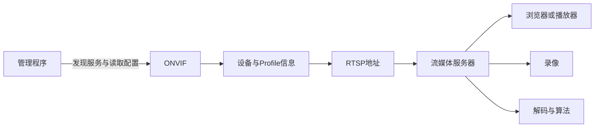

视频平台的第一步是让一条流可接入、可播放。先理解设备、通道、流配置和播放路径，再考虑数据库和调度；下面是设计说明与操作入口，不是一份完整平台工程。

## 四个对象怎样区分

| 对象 | 含义 | 示例 |
| --- | --- | --- |
| Device | 一台相机或 NVR | 设备 A |
| Channel | 该设备的一路视频来源 | 通道 1 |
| Profile | 一组媒体配置，带协议返回的 token | 通道 1 的某个分辨率与编码配置 |
| Media path | 流媒体服务器给消费端使用的路径 | `camera-a/main` |

一个 NVR 可能有多个通道，同一通道又可能有多个 Profile。ONVIF Profile Token 是不透明标识，不能用末尾数字直接推导通道号，也不能按返回顺序认定主码流和子码流。

## 两条请求链



ONVIF 多用于发现、配置和控制，RTSP 负责协商与拉取媒体；它们端口和认证可能不同。ONVIF 请求成功不代表 RTSP 一定能拉到帧，API 正常也不代表浏览器媒体连接可达。

## 按顺序跑通一条流

1. 在设备管理页确认 RTSP/ONVIF 已启用，并准备有权限的账号。
2. 用 ONVIF 返回的服务地址和 Profile Token 请求 URI，或先使用厂商提供的明确 RTSP 路径。
3. 用 ffprobe 检查编码与尺寸，再用播放器确认能看到画面。
4. 接入一个流媒体服务器，验证服务端是否已注册这条流。
5. 用目标客户端实际播放，最后才添加录像或算法消费。

PowerShell 中可用下面的探测命令，URI 填自己的设备地址：

```powershell
$env:RTSP_URL = 'rtsp://用户名:密码@相机IP:554/实际路径'
ffprobe -v error -rtsp_transport tcp -select_streams v:0 -show_entries stream=codec_name,width,height,r_frame_rate -of json $env:RTSP_URL
```

TCP 可以减少 UDP 丢包导致的解码问题，但还会受到队头阻塞和网络延迟影响，不能称为任何网络下都更快。

## 封装转换与转码

流媒体服务器可以把兼容的压缩数据转换为另一种传输封装，这通常不需要逐帧解码。目标播放器不支持源编码时，才需要 FFmpeg 等工具解码并重新编码；修改路径或把 RTSP 变成 HLS 不会自动把 H.265 变成 H.264。

先选择一种主链路完成练习：[ZLMediaKit 入门](/blog/zlmediakit-start/) 或 [MediaMTX 接入与播放](/blog/b2cajl4xw/)。不同服务器的 API 和路径规则不同，代码与配置不能互相混用。

## 开始做平台时保存什么

保存设备 ID、通道标识、原始 Profile Token、编码配置、媒体路径，以及各自的实际状态。凭据单独保护，播放 URI 进入日志前脱敏。

设备配置更新和流媒体配置下发是两个操作，数据库事务不能自动回滚外部进程状态。记录期望配置、下发结果和实际可读状态，失败时再按可重试性补偿；不要为了更新普通字段先删除正在播放的路径。

下一篇：[录像存储与检索](/blog/b3t6f601o/)。参考：[ONVIF 规范](https://www.onvif.org/profiles/specifications/)、[MediaMTX 重新编码](https://mediamtx.org/docs/features/re-encoding)。
