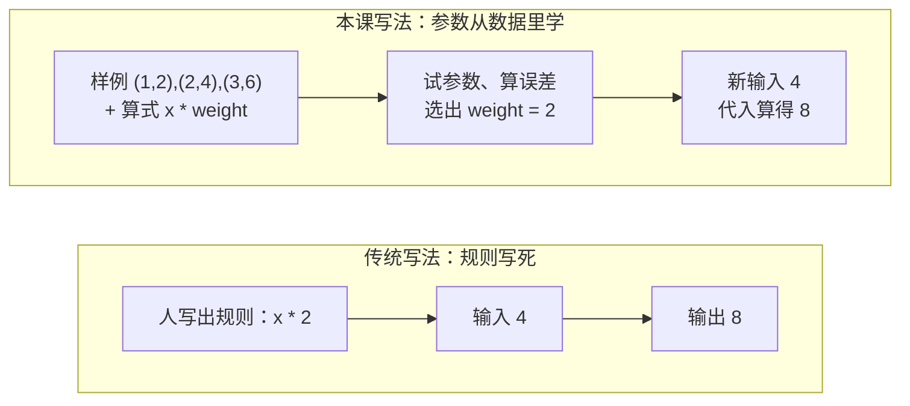
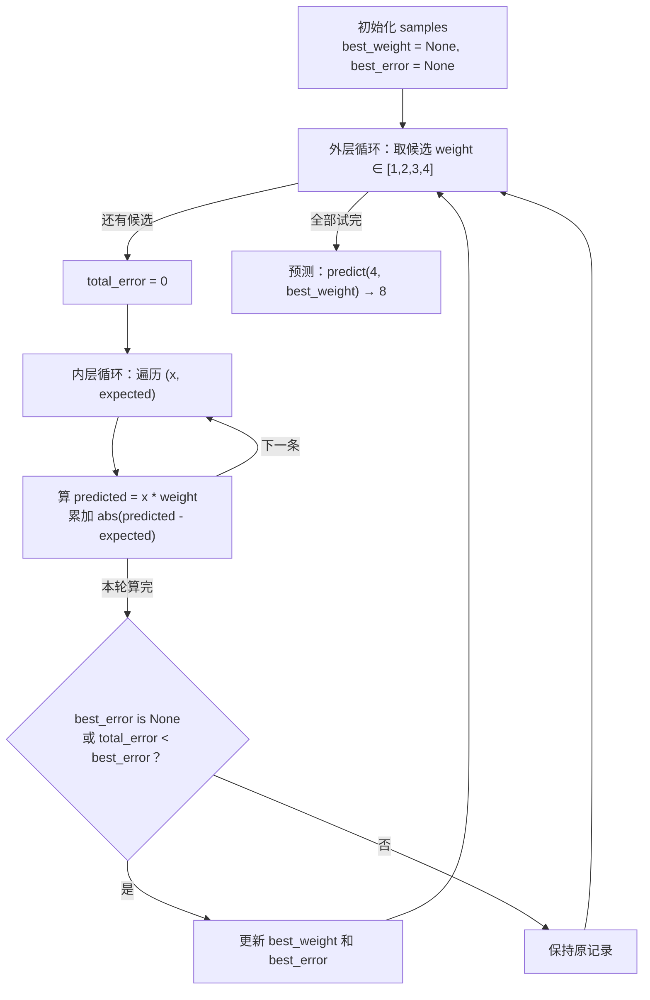

**第一阶段只做一件事：用纯 Python 写出一个能从样例中学出参数、再预测新输入的小模型。**

你已经有编程基础，所以直接看代码和运行过程；Python 特有的语法和关键设计点会在代码下方一次讲透。

## 1. 先看思路：不写死规则，让程序自己找参数

传统写法是**人先把规律写成代码**（例如 `return x * 2`）。而让程序“学习”，是**人只给出三组带答案的样例 `[(1, 2), (2, 4), (3, 6)]` 和带空缺的算式 `x * weight`**，让程序自己尝试几个候选数，把**总误差最小**的那个 `weight` 留下来，再去算新输入 `4` 的结果。



---

## 2. 运行代码：`lesson01.py`

新建 `lesson01.py`（或直接下载 [lesson01.py](/examples/agent/lesson01.py)），用 `python lesson01.py` 运行，无需安装第三方库：

```python
# 每一组都是：（输入，正确答案）
samples = [(1, 2), (2, 4), (3, 6)]


# 给定输入和参数，计算预测结果
def predict(x, weight):
    return x * weight


# None 表示暂时还没有最优记录
best_weight = None
best_error = None

# 依次尝试四个候选参数
for weight in [1, 2, 3, 4]:
    total_error = 0

    # 用每一组样例检查当前参数
    for x, expected in samples:
        predicted = predict(x, weight)
        error = abs(predicted - expected)
        total_error += error

    print("尝试参数：", weight, "总误差：", total_error)

    # 第一次直接记录；之后只保留总误差更小的参数
    if best_error is None or total_error < best_error:
        best_weight = weight
        best_error = total_error

print("学到的参数：", best_weight)
print("输入 4，预测结果：", predict(4, best_weight))
```

运行输出：

```text
尝试参数： 1 总误差： 6
尝试参数： 2 总误差： 0
尝试参数： 3 总误差： 6
尝试参数： 4 总误差： 12
学到的参数： 2
输入 4，预测结果： 8
```

### Python 写法与 3 个关键设计

| 写法 / 设计 | 作用与原因 |
| --- | --- |
| `def` 与 4 空格缩进 | Python 不用 `{}`，靠冒号和缩进划分函数和循环作用域 |
| `for x, expected in samples:` | 遍历列表里的元组并自动拆包，把一对数分别赋给 `x` 和 `expected` |
| `abs(predicted - expected)` | 取绝对值作为单条误差，避免一组多猜 `+2`、另一组少猜 `-2` 时正负抵消成 `0` |
| `best_error is None or ...` | `None` 类似 `null`；不初始化成 `0`（否则更小误差进不来）或 `9999`，用短路 `or` 接住第 1 轮并避免拿 `None` 比大小报错 |
| `total_error = 0` 放在外层循环内 | 每换一个候选 `weight` 都要清空重算，避免把上一轮误差累加进来 |

---

## 3. 图解每一步：循环、误差与预测

### 控制流：两层循环和一次更新判断



### 动态交互演示：逐帧看直线、误差和变量怎么变

点击 **“下一步”** 或 **“▶ 播放演示”**，观察直线怎样随 `weight` 转动、每组样例误差如何相加、最优参数何时更新；也可切换顶部 **“练习：3 倍规律”** 对照结果。

<param-learning-demo mode="double">
  <p>交互演示需要 JavaScript。文字版流程：程序依次尝试候选参数 1、2、3、4，分别计算三组样例总误差（6、0、6、12），在试到 weight = 2 时发现总误差降到 0 并更新最优参数，最后固定 weight = 2 算出输入 4 的预测结果 8。</p>
</param-learning-demo>

---

## 4. 对照 AI 常见概念

这 20 多行代码已经走完了一次完整的最小机器学习闭环：

| 代码部分 | 对应概念 | 在本例中的作用 |
| --- | --- | --- |
| `predict(x, weight) = x * weight` | **模型（Model）** | 规定怎么根据输入算结果的公式骨架 |
| `weight` | **参数（Parameter）** | 公式里待定、由程序从数据中学出的数值 |
| `abs(predicted - expected)` 求和 | **误差 / 损失（Error / Loss）** | 衡量当前参数有多不准，越小越好 |
| `for weight in [1, 2, 3, 4]: ...` | **训练（Training）** | 在样例上对比候选参数并保留最优解（**看答案挑参数**） |
| `predict(4, best_weight)` | **预测 / 推理（Prediction）** | 固定参数后处理新输入，不再改动 `weight`（**只算结果**） |

---

## 5. 动手练习与当前边界

只把 `lesson01.py` 第一行改成：

```python
samples = [(1, 3), (2, 6), (3, 9)]
```

**其余代码保持不变，重新运行一次。** 程序应自行输出 `学到的参数： 3` 和 `输入 4，预测结果： 12`（验收点：计算规则 `predict()` 没变，只换数据就能学出新参数）。

同时也要看清这一课的两个限制，这也是[第 2 课](/tutorials/tagent-lesson02/)要解决的问题：

1. 候选列表 `[1, 2, 3, 4]` 写死了整数，遇到 `2.5` 或 `10` 倍规律就找不到。
2. 公式只有乘法 `x * weight`，遇到 `2 * x + 1` 这类带偏移的数据也无法拟合到误差为 `0`。
