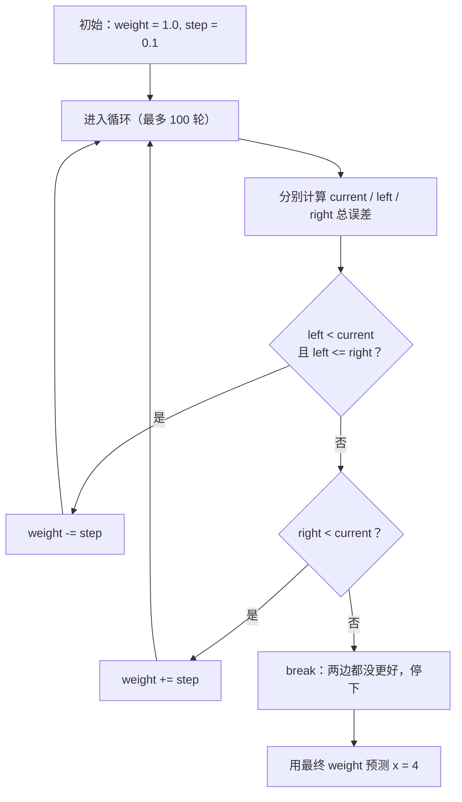

[第 1 课](/tutorials/tagent-lesson01/)只能从写死的 `[1, 2, 3, 4]` 里挑整数。如果把样例换成 `2.5` 倍——`[(1, 2.5), (2, 5.0), (3, 7.5)]`，穷举列表就失效了；而手写 `[0.1, 0.2, ..., 10.0]` 在参数变多后很快会爆炸。

这一课改用更聪明的做法：**从一个初始参数出发，每次左右试探一小步，哪边误差更小就往哪边走。**

## 1. 试探思路：沿着误差“山谷”往下走

把不同 `weight` 算出来的总误差画成曲线，刚好是一个 **V 字形山谷**，谷底就是正确答案 `2.5`（总误差 `0.0`）。程序不需要知道整张图，只要在当前 `weight` 处，按预设**步长 `step = 0.1`** 往左、往右各看一眼：

| 试探位置 | 参数值 | 3 组样例总误差 |
| --- | ---: | ---: |
| 往小调（`weight - step`） | `0.9` | `9.6` |
| 当前不动（`weight`） | `1.0` | `9.0` |
| 往大调（`weight + step`） | `1.1` | `8.4` |

`8.4 < 9.0`，说明往大调是下坡，就把 `weight` 改成 `1.1`，下一轮继续试探，直到两边误差都不再变小为止。

---

## 2. 运行代码：`lesson02.py`

新建 `lesson02.py`（或直接下载 [lesson02.py](/examples/agent/lesson02.py)），复制运行：

```python
samples = [(1, 2.5), (2, 5.0), (3, 7.5)]


# 使用当前参数进行预测
def predict(x, weight):
    return x * weight


# 用全部样例计算总误差
def calculate_error(weight):
    total_error = 0

    for x, expected in samples:
        predicted = predict(x, weight)
        total_error += abs(predicted - expected)

    return total_error


weight = 1.0  # 从这个初始参数出发
step = 0.1    # 每次试探调整的幅度（步长）

# 最多尝试 100 轮，避免一直停不下来
for attempt in range(100):
    current_error = calculate_error(weight)
    left_error = calculate_error(weight - step)
    right_error = calculate_error(weight + step)

    print("第", attempt + 1, "轮：weight =", round(weight, 4), "总误差 =", round(current_error, 4))

    # 往小调更好，并且不比往大调差
    if left_error < current_error and left_error <= right_error:
        weight -= step

    # 往大调更好
    elif right_error < current_error:
        weight += step

    # 两边都没有改善，提前结束循环
    else:
        break

print("学到的参数：", round(weight, 4))
print("总误差：", round(calculate_error(weight), 4))
print("输入 4，预测结果：", round(predict(4, weight), 4))
```

运行输出：

```text
第 1 轮：weight = 1.0 总误差 = 9.0
第 2 轮：weight = 1.1 总误差 = 8.4
第 3 轮：weight = 1.2 总误差 = 7.8
第 4 轮：weight = 1.3 总误差 = 7.2
第 5 轮：weight = 1.4 总误差 = 6.6
第 6 轮：weight = 1.5 总误差 = 6.0
第 7 轮：weight = 1.6 总误差 = 5.4
第 8 轮：weight = 1.7 总误差 = 4.8
第 9 轮：weight = 1.8 总误差 = 4.2
第 10 轮：weight = 1.9 总误差 = 3.6
第 11 轮：weight = 2.0 总误差 = 3.0
第 12 轮：weight = 2.1 总误差 = 2.4
第 13 轮：weight = 2.2 总误差 = 1.8
第 14 轮：weight = 2.3 总误差 = 1.2
第 15 轮：weight = 2.4 总误差 = 0.6
第 16 轮：weight = 2.5 总误差 = 0.0
学到的参数： 2.5
总误差： 0.0
输入 4，预测结果： 10.0
```

### 新增写法与关键细节

| 代码 / 角色 | 说明 |
| --- | --- |
| `def calculate_error(weight):` | 把算总误差抽成函数，方便每轮一次比较当前、左边、右边三个位置的误差 |
| `range(100)` 与 `break` | 给循环设 `100` 轮上限防止死循环；两边都不再变小时用 `break` 提前退出 |
| `left_error <= right_error` | 若左右都比当前更小，保证优先挑误差更小的一边，而不是死板只看代码顺序 |
| `round(..., 4)` | 二进制小数连加 15 次 `0.1` 会带出极小尾数（如 `2.5000000000000013`），训练中保留原值，打印时保留 4 位小数 |
| `weight` vs `step` | `weight` 是训练中被修改的模型参数；`step` 是人预先设好的步长，训练时不变 |

---

## 3. 图解每一步：三路判断与 V 形误差曲线



点击下方 **“▶ 播放演示”** 或 **“下一步”**，对比三种情况：**精细步长 `step = 0.1`**、**步子太大 `step = 1.0`**，以及 **从大往小 `w = 3.5`**（直接触发 `weight -= step` 分支）。

<step-adjust-demo mode="fine">
  <p>交互演示需要 JavaScript。默认以 step = 0.1 从 weight = 1.0 出发，连续 15 次往大调整后在第 16 轮停在 weight = 2.5（总误差 0.0），预测输入 4 得到 10.0；如果把 step 改成 1.0，程序在 weight = 2.0 处试探 1.0（误差 9.0）和 3.0（误差 3.0）都没有更小，就会提前停止并把 2.5 跨过去。</p>
</step-adjust-demo>

---

## 4. 动手实验：步子太大会怎样？

只把 `lesson02.py` 里的步长改成 `step = 1.0`，再运行一次：

```text
第 1 轮：weight = 1.0 总误差 = 9.0
第 2 轮：weight = 2.0 总误差 = 3.0
学到的参数： 2.0
总误差： 3.0
输入 4，预测结果： 8.0
```

程序只走了两轮就卡在了 `2.0`：在 `weight = 2.0`（误差 `3.0`）处，左边 `1.0` 误差是 `9.0`，右边 `3.0` 误差也是 `3.0`，**都不满足 `< 3.0`**，于是触发 `break` 停下——答案 `2.5` 正好被 `step = 1.0` 这步跨过去了。

[admonition title="顺手验证另一个分支" color="blue"]把 `step` 改回 `0.1`，再把初始 `weight = 1.0` 改成 `weight = 3.5`，程序会触发 `weight -= step` 分支，从右边一路走回 `2.5`（也可在上方交互演示切换 **“从大往小：w = 3.5”** 直接观看）。[/admonition]

这一课记住两点就够了：**自动调参就是“试探周边误差 → 朝更小的一边挪步 → 走不动时停下”；而 `break` 停下只代表按当前步长没找到更好的邻近点，步长太大仍会错过正解。**
