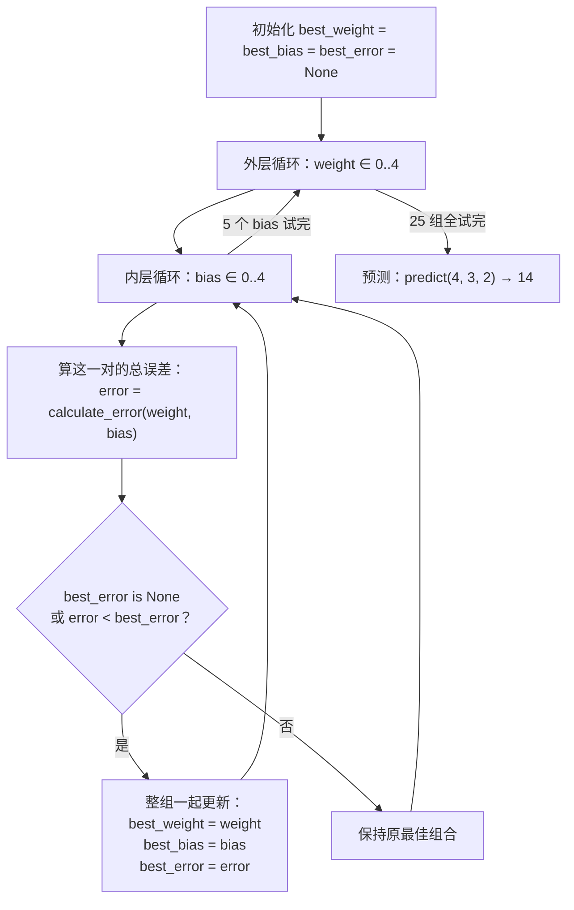

前两课的计算公式 `x * weight` 有个硬伤：输入 `0` 时输出必定是 `0`。一旦样例不再经过原点——例如 `[(1, 5), (2, 8), (3, 11)]`（`x` 每加 1，结果涨 3，但整体还多出 `2`），单靠一个乘法参数就无法凑出正确答案。

**这一课只加一个新东西：给模型增加第二个参数 `bias`（偏置），让程序学会同时挑选两个参数。**

## 1. `weight` 和 `bias` 各自管什么？

把预测公式改成：

```python
预测结果 = 输入 * weight + bias
```

| 参数 | 管什么 | 本例合适值 | 几何直觉 |
| --- | --- | ---: | --- |
| `weight` | 输入乘多少 | `3` | 控制直线倾斜多陡（`x` 每多 1，输出涨多少） |
| `bias` | 乘完再加多少 | `2` | 控制整体上下平移（`x = 0` 时从几开始） |

代入三组样例立刻全对：`1×3+2=5`、`2×3+2=8`、`3×3+2=11`。注意 `bias` 对所有输入都加同一个固定值，但它具体取几，依然由程序通过训练自己找出来。

---

## 2. 运行代码：`lesson03.py`

新建 `lesson03.py`（或直接下载 [lesson03.py](/examples/agent/lesson03.py)），沿用第 1 课的枚举思路，把 `weight` 和 `bias` 各自试 `0～4`（共 `5 × 5 = 25` 组搭配）：

```python
samples = [(1, 5), (2, 8), (3, 11)]


# 模型现在有两个参数
def predict(x, weight, bias):
    return x * weight + bias


# 检查这组参数在全部样例上的总误差
def calculate_error(weight, bias):
    total_error = 0

    for x, expected in samples:
        predicted = predict(x, weight, bias)
        total_error += abs(predicted - expected)

    return total_error


best_weight = None
best_bias = None
best_error = None

# range(5) 依次产生 0、1、2、3、4
for weight in range(5):
    for bias in range(5):
        error = calculate_error(weight, bias)

        # 保留误差最小的一整组参数
        if best_error is None or error < best_error:
            best_weight = weight
            best_bias = bias
            best_error = error

print("weight =", best_weight)
print("bias =", best_bias)
print("总误差 =", best_error)
print("输入 4，预测结果 =", predict(4, best_weight, best_bias))
```

运行输出：

```text
weight = 3
bias = 2
总误差 = 0
输入 4，预测结果 = 14
```

### 重点看懂：两个参数必须“成对”评价与更新

- `range(5)` 生成 `0, 1, 2, 3, 4`，双层循环一共扫描 `25` 组搭配。
- 不能单独挑 `best_weight` 再单独挑 `best_bias`，比如 `(2, 2)` 和 `(3, 0)` 的总误差都是 `6`，只有 `(3, 2)` 这一对搭配才能把总误差降到 `0`。所以 `if` 成立时必须把 `best_weight`、`best_bias`、`best_error` **作为一整组一起覆盖**。
- `return x * weight + bias` 是人设计的**模型结构**；找到 `3` 和 `2` 是程序完成的**参数训练**——这两件事完全分开。

---

## 3. 图解双参数搜索：控制流与 5×5 误差矩阵



点击 **“▶ 播放演示”** 可以观看 `25` 组组合扫描时直线怎样一边转角度、一边上下平移；也可以**直接点击下方 5×5 矩阵里的任意格子**对比不同 `(weight, bias)` 的拟合效果。

<two-param-demo mode="affine32">
  <p>交互演示需要 JavaScript。默认样例 [(1, 5), (2, 8), (3, 11)] 遍历 weight ∈ 0..4 与 bias ∈ 0..4 共 25 组组合，在 (3, 2) 处总误差降为 0，并用 predict(4, 3, 2) 预测出 14。</p>
</two-param-demo>

---

## 4. 动手练习

只把 `lesson03.py` 第一行样例改成：

```python
samples = [(1, 6), (2, 8), (3, 10)]
```

保持其余代码不动运行，应该输出：`weight = 2`、`bias = 4`、`总误差 = 0`、`输入 4，预测结果 = 12`（也可在上方交互演示切换到 **“练习：2x + 4”** 直接核对）。

不过前三课我们都只验证模型能不能答对训练样例本身。如果遇到没参加调参的新输入，模型还能答对吗？下一课进入[第 4 课：用新数据检查模型](/tutorials/tagent-lesson04/)，我们拆出独立的测试集来检验。
