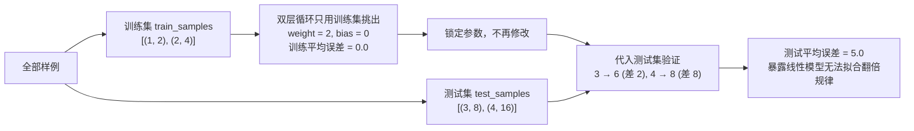

前面三课我们只检查模型能不能答对训练样例。从这一课开始多做一步：**留出一部分从未参与调参的数据，训练完成后再检查它的预测。**

## 1. 把数据分成训练集与测试集

准备一组答案依次翻倍的教学数据，刻意拆成两部分：

| 输入 | 正确答案 | 用途 |
| --- | ---: | --- |
| `1` | `2` | 参与训练（`train_samples`） |
| `2` | `4` | 参与训练（`train_samples`） |
| `3` | `8` | 训练完成后检查（`test_samples`） |
| `4` | `16` | 训练完成后检查（`test_samples`） |

- **训练集（`train_samples`）**：选参数循环只看这一部分，程序根据它调整 `weight` 和 `bias`。
- **测试集（`test_samples`）**：参数确定并锁定后，才拿出来检验真实预测能力。

模型沿用第 3 课的公式 `x * weight + bias`。如果只用前两组训练，它能猜对后两组吗？

---

## 2. 运行代码：`lesson04.py`

新建 `lesson04.py`（或直接下载 [lesson04.py](/examples/agent/lesson04.py)），把误差函数改成通用版本，传入哪组数据就计算该组上的**平均误差**：

```python
train_samples = [(1, 2), (2, 4)]
test_samples = [(3, 8), (4, 16)]


def predict(x, weight, bias):
    return x * weight + bias


# 传入哪组数据，就计算在哪组数据上的平均误差
def calculate_error(samples, weight, bias):
    total_error = 0

    for x, expected in samples:
        predicted = predict(x, weight, bias)
        total_error += abs(predicted - expected)

    return total_error / len(samples)


best_weight = None
best_bias = None
best_error = None

for weight in range(5):
    for bias in range(5):
        # 选参数时，只使用训练集
        error = calculate_error(train_samples, weight, bias)

        if best_error is None or error < best_error:
            best_weight = weight
            best_bias = bias
            best_error = error

# 参数已经确定，分别检查两组数据
train_error = calculate_error(train_samples, best_weight, best_bias)
test_error = calculate_error(test_samples, best_weight, best_bias)

print("weight =", best_weight, "bias =", best_bias)
print("训练平均误差：", train_error)
print("测试平均误差：", test_error)

for x, expected in test_samples:
    predicted = predict(x, best_weight, best_bias)
    print("输入：", x, "预测：", predicted, "正确答案：", expected)
```

这里用 `total_error / len(samples)` 计算每条样例平均差多少，避免训练集和测试集条数不同时没法直接比较大小。

运行结果：

```text
weight = 2 bias = 0
训练平均误差： 0.0
测试平均误差： 5.0
输入： 3 预测： 6 正确答案： 8
输入： 4 预测： 8 正确答案： 16
```

---

## 3. 为什么训练全对，新输入却算错了？

程序找到的直线是 `x * 2 + 0`：它完美命中前两组（`1 → 2`、`2 → 4`），所以训练平均误差是 `0.0`。但后面两组是按 `2、4、8、16` **翻倍**增长的，而一条直线在输入每加 `1` 时只能让结果增加固定步长 `weight`——**它从结构上就无法同时贴合这四个点。**

前两组两点成一线，暂时掩盖了矛盾；未见过的测试集把问题立刻暴露了出来：

- `x = 3`：模型猜 `6`，正确答案 `8`（误差 `2`）
- `x = 4`：模型猜 `8`，正确答案 `16`（误差 `8`）
- 两题平均差了 `(2 + 8) / 2 = 5.0`

**训练误差为 0，只能说明模型背对了训练样例；对新数据行不行，必须单独用测试集验证。**



点击 **“▶ 播放演示”** 可以逐步查看：程序怎样先封存测试集、仅凭训练集挑出 `(2, 0)`，又怎样在解封测试集时被 `(3, 8)` 和 `(4, 16)` 拉出红色误差线：

<train-test-demo mode="doubling">
  <p>交互演示需要 JavaScript。默认样例先用 train_samples = [(1, 2), (2, 4)] 选出 weight = 2、bias = 0（训练平均误差 0.0），解封 test_samples = [(3, 8), (4, 16)] 后预测为 6 和 8，测试平均误差 5.0；切换为练习组 [(1, 3), (2, 5)] 与 [(3, 7), (4, 9)] 时训练与测试误差均为 0.0。</p>
</train-test-demo>

---

## 4. 动手练习：换回同一条直线试试

只把 `lesson04.py` 最上面两行数据改成：

```python
train_samples = [(1, 3), (2, 5)]
test_samples = [(3, 7), (4, 9)]
```

重新运行后应该输出：

```text
weight = 2 bias = 1
训练平均误差： 0.0
测试平均误差： 0.0
输入： 3 预测： 7 正确答案： 7
输入： 4 预测： 9 正确答案： 9
```

也可直接在上方演示点击 **“课后练习：2x + 1”** 对比观察：训练负责选参数，测试负责验收参数在未见数据上的表现。当规律真的是一条直线 `2x + 1` 时，测试集也能全部答对；那如果规律本身确实在翻倍呢？下一课就来解决这个问题。
