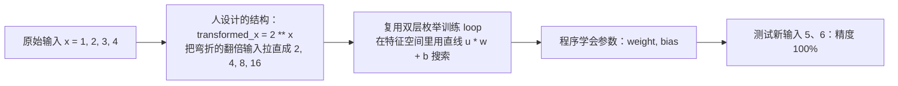

上一课模型遇到 `2、4、8、16` 这样的翻倍规律时测试失败了——因为直线 `x * weight + bias` 弯不过来。这一课不改训练循环，**只在预测函数里先把输入变换一步，再看模型能否答对新输入。**

## 1. 给计算过程增加一步变换

之前直接拿原始输入乘加：`输入 * weight + bias`。现在改成先对 `2` 做输入次方，再去乘 `weight` 加 `bias`：

```python
预测结果 = (2 ** 输入) * weight + bias
```

在 Python 里，`**` 表示乘方（例如 `2 ** 3` 就是 `2 * 2 * 2 = 8`）。变换后数字的变化非常明显：

| 原始输入 `x` | 变换后的 `2 ** x` |
| --- | ---: |
| `1` | `2` |
| `2` | `4` |
| `3` | `8` |
| `4` | `16` |

**输入 `x` 每加 `1`，`2 ** x` 自己就会翻倍。** 把“翻倍能力”放进计算结构里后，训练只需确定最外层的倍率 `weight` 和起点微调 `bias`。

---

## 2. 运行代码：`lesson05.py`

直接沿用 `lesson04.py` 的选参框架，保存为 `lesson05.py`（或下载 [lesson05.py](/examples/agent/lesson05.py)），只修改最上方的数据与 `predict()` 函数两处：

```python
train_samples = [(1, 2), (2, 4), (3, 8), (4, 16)]
test_samples = [(5, 32), (6, 64)]


def predict(x, weight, bias):
    # 先处理输入
    transformed_x = 2 ** x

    # 再使用参数计算结果
    return transformed_x * weight + bias


# 传入哪组数据，就计算在哪组数据上的平均误差
def calculate_error(samples, weight, bias):
    total_error = 0

    for x, expected in samples:
        predicted = predict(x, weight, bias)
        total_error += abs(predicted - expected)

    return total_error / len(samples)


best_weight = None
best_bias = None
best_error = None

for weight in range(5):
    for bias in range(5):
        # 选参数时，只使用训练集
        error = calculate_error(train_samples, weight, bias)

        if best_error is None or error < best_error:
            best_weight = weight
            best_bias = bias
            best_error = error

# 参数已经确定，分别检查两组数据
train_error = calculate_error(train_samples, best_weight, best_bias)
test_error = calculate_error(test_samples, best_weight, best_bias)

print("weight =", best_weight, "bias =", best_bias)
print("训练平均误差：", train_error)
print("测试平均误差：", test_error)

for x, expected in test_samples:
    predicted = predict(x, best_weight, best_bias)
    print("输入：", x, "预测：", predicted, "正确答案：", expected)
```

这次把上节课分析过的 `x = 3, 4` 一起并入训练集，留出从未见过的 `x = 5, 6` 做测试集。运行输出：

```text
weight = 1 bias = 0
训练平均误差： 0.0
测试平均误差： 0.0
输入： 5 预测： 32 正确答案： 32
输入： 6 预测： 64 正确答案： 64
```

程序挑出了 `weight = 1`、`bias = 0`，等价于 `(2 ** x) * 1 + 0`，未参与训练的 `5` 和 `6` 全部精确命中。

---

## 3. 图解核心思想：人定结构，程序找参数

为什么换了一步 `2 ** x`，原本的直线查找方法立刻就管用了？看看流程和双坐标系变化：



这一步要分清两个角色：

- **人设计的部分**：你发现答案按倍增长，于是往 `predict()` 里加入 `2 ** x`，赋予模型翻倍的计算结构。
- **程序学到的部分**：给定这个结构后，程序自己从训练集里找出 `weight = 1`、`bias = 0`。

点开下方演示，对比上方**原始坐标系 `(x, y)`** 和下方**变换后坐标系 `(2 ** x, y)`**：一旦算完 `2 ** x`，原本陡峭弯曲的点瞬间排成一条笔直的斜线，同样的参数搜索方法一击命中。

<feature-transform-demo mode="exp_basic">
  <p>交互演示需要 JavaScript。默认例题先计算 transformed_x = 2 ** x 将 x=1..4 映射到 [2, 4, 8, 16]，双层枚举从训练集选出 weight = 1、bias = 0，测试集 x=5, 6 预测为 32 和 64（误差 0.0）；切换课后练习组时学会 weight = 3、bias = 1，测试 x=5, 6 预测为 97 和 193（误差 0.0）。</p>
</feature-transform-demo>

---

## 4. 练习与第一阶段收官：让两个参数真正起作用

把 `lesson05.py` 顶部的数据替换成下面这组（其他代码一个字都不改）：

```python
train_samples = [(1, 7), (2, 13), (3, 25), (4, 49)]
test_samples = [(5, 97), (6, 193)]
```

重新运行，你会得到：

```text
weight = 3 bias = 1
训练平均误差： 0.0
测试平均误差： 0.0
输入： 5 预测： 97 正确答案： 97
输入： 6 预测： 193 正确答案： 193
```

拿 `x = 2` 手动算一次就能验证 `(2 ** 2) * 3 + 1 = 4 × 3 + 1 = 13`。只改样例、不改算法，同一段“先变换输入，再乘加调参”的程序就自己学会了 `weight = 3, bias = 1`。

到这里，第一阶段的 5 课已经完整打通：**输入变换与模型结构设计 → 训练集搜索参数 → 测试集验证新输入 → 模型泛化预测。**
