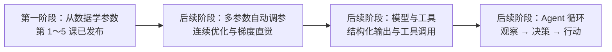

很多教程一上来就介绍框架、提示词和外部接口，写完还是容易把大模型当成“黑盒”。这套专栏换一种做法：**从最小可运行的 Python 代码出发，亲手把关键机制拆开看透，再逐阶段叠加能力。**

当前已完成**第一阶段的全部 5 课**，后续阶段会在整理完成后陆续补充。

## 整体学习路线

## 已上线内容

| 课次 | 教程 | 本课只解决这一件事 |
| --- | --- | --- |
| 第 1 课 | [程序怎样从数据里“学”到东西](/tutorials/tagent-lesson01/) | 用约 20 行纯 Python 从固定候选列表里挑出误差最小的参数，再预测新输入 |
| 第 2 课 | [让程序自己小步调整参数](/tutorials/tagent-lesson02/) | 不再枚举固定列表，改用左右试探与步长让程序沿误差曲线自己走到 `2.5` |
| 第 3 课 | [让模型学会“乘一个数，再加一个数”](/tutorials/tagent-lesson03/) | 引入第二个参数 `bias`，让程序从 25 组搭配里同时学出斜率与偏置 |
| 第 4 课 | [用新数据检查模型](/tutorials/tagent-lesson04/) | 拆分 `train_samples` 与 `test_samples`，用平均误差揭开“训练全对却测错”的原因 |
| 第 5 课 | [先变换输入，再训练参数](/tutorials/tagent-lesson05/) | 在 `predict()` 中加入 `2 ** x` 输入变换，复用训练循环直接拟合翻倍规律 |

## 适合谁看、怎么学

- **前置要求**：你已经了解变量、`for` 循环、`if` 判断和函数调用（比如用过 Java、JavaScript、C/Go 等任意语言），不需要先学高等数学或安装深度学习框架。
- **环境要求**：本机安装 Python 3 即可；第一阶段只使用 Python 标准功能，不需要 `pip install`。
- **阅读方式**：每课只聚焦一个核心动作，先跑通代码、看懂动态执行图解，再动手修改参数做一次验收练习。

## 示例源码

- 第 1 课脚本：[lesson01.py](/examples/agent/lesson01.py)
- 第 2 课脚本：[lesson02.py](/examples/agent/lesson02.py)
- 第 3 课脚本：[lesson03.py](/examples/agent/lesson03.py)
- 第 4 课脚本：[lesson04.py](/examples/agent/lesson04.py)
- 第 5 课脚本：[lesson05.py](/examples/agent/lesson05.py)
