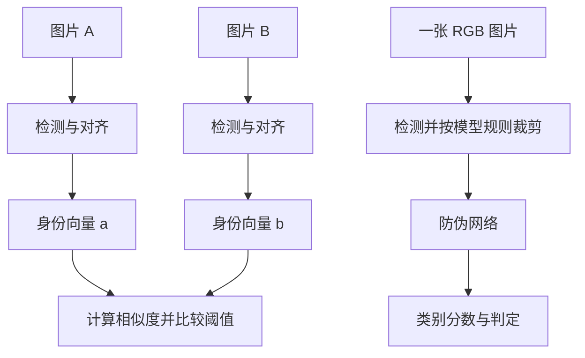

给算法两张照片，怎么判断是不是同一个人？只给一张照片，又怎么判断它是直接拍摄的人脸，还是翻拍的照片、屏幕？

这两件事都从图片开始，但要提取的特征不同。

## 两条流程

| 任务 | 输入 | 中间计算 | 输出 |
| --- | --- | --- | --- |
| 人脸比对 | 图片 A、图片 B | 各自提取身份特征，计算相似度 | 相似度、是否判为同人 |
| 单图活体 | 一张 RGB 图片 | 提取纹理、成像等防伪特征 | 真人类分数、是否判为真人类 |
| 姿态估计 | 一张图片 | 关键点与几何计算 | 当前偏转角、嘴眼开合量 |

这里的“单图活体”指单张 RGB 图像的呈现攻击检测（PAD）：根据图像里保留下来的线索，区分真人采集与照片、屏幕等攻击。结果是模型判断，无法从任意一张图中确定还原它的拍摄来源。

人脸比对希望同一个人换光照、换姿态后，特征仍然接近。防伪则需要保留某些成像差异，例如重拍纹理、显示屏干扰和材质反光。把身份向量直接拿去判断活体，训练目标就不匹配。

## 阅读顺序

- [人脸比对](/tutorials/tface-compare/)：找脸、对齐、特征网络、ArcFace、余弦相似度。
- [单图活体](/tutorials/tface-pad/)：防伪线索、卷积特征、训练、推理和阈值。
- [姿态计算](/tutorials/tface-actions/)：一张图怎样计算左右偏转、张嘴和闭眼。
- [算法示例](/tutorials/tface-engineering/)：两图比对、单图防伪和几何计算的独立 Python 示例。

## 算法各做什么

人脸检测器输出脸的位置，常见的有 Haar、MTCNN、RetinaFace、YuNet。它们解决“哪里有脸”，检测置信度不能拿来表示“是谁”或“是否活体”。

对齐用眼睛、鼻尖和嘴角等关键点，把脸变换到统一位置。身份网络再把脸图变成固定长度的向量，最后比较两个向量。

防伪可以用手工纹理特征加分类器，也可以用 MiniFASNet 等轻量网络直接学习。单张 RGB、多帧视频、红外和真实深度是不同输入条件，不能只换个算法名称就互相替代。

本文的示例分别采用 OpenCV 的 YuNet + SFace，以及 Silent-Face 的 MiniFASNet。ArcFace 用来解释身份特征如何训练；示例里的 SFace 是另一种身份表征方法，两者不共用权重或阈值。OpenCV 的[官方示例](https://docs.opencv.org/4.x/d0/dd4/tutorial_dnn_face.html)也将检测、对齐、特征和比对分开调用。

读代码时，可以沿着这些变量看：`image → face → tensor → feature/logits → score → decision`。后面每篇都围绕其中的计算展开。
