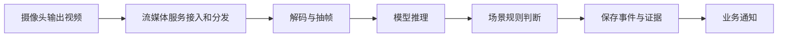

这个系列记录视频智能分析平台的学习与设计。当前已整理 [前置知识](/tutorials/tr1d7ssm7/)，后续实现章节尚未完成。

## 先看懂处理流程

ONVIF 用于获取设备、媒体配置等信息；视频通常通过 RTSP 等协议读取。流媒体服务负责接入和分发，FFmpeg 或推理程序负责解码、转码和抽帧。

模型输出检测框或分类结果后，还需要规则判断、去重和事件保存，才能形成可用的告警。

## 已有学习材料

- [前置知识](/tutorials/tr1d7ssm7/)：认识项目范围与常用组件。
- [FFmpeg 教程](/tutorials/ffmpeg/)：查看媒体信息、选流、转码与网络传输。
- [ZLMediaKit 入门](/blog/zlmediakit-start/)：在本机接入、播放和转码。
- [MediaMTX 接入与播放](/blog/b2cajl4xw/)：接入摄像头并验证网页播放。

## 后续写作方向

先完成一路相机的接入和播放，再实现抽帧推理、事件与证据保存，最后讨论多任务调度和通知。每一步都应给出输入、命令、预期输出和验证方法。

多场景算法、LLM 总结、模型训练与容量规划属于后续内容，不能根据本页目录认定它们已经实现。
